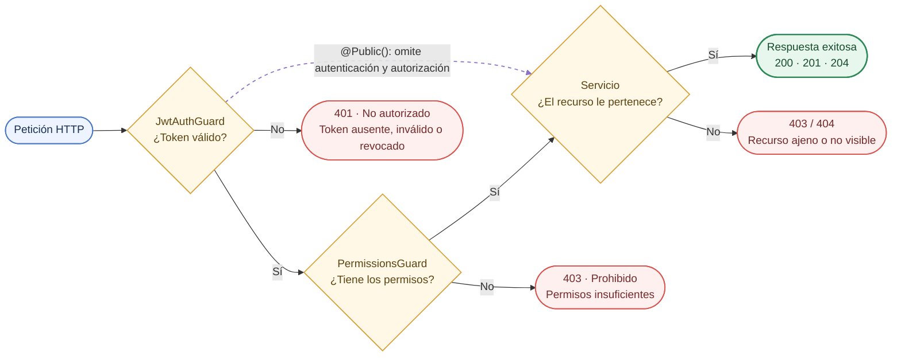

# **Informe — Elpepesetch Multimedia App**

_Computación en Internet III_

## Capa de Seguridad y usuarios

### Alcance

Toda petición pasa por dos guards globales: primero se verifica quién es el usuario (`JWT`) y después qué puede hacer (permisos de su rol). Ninguna ruta queda abierta por omisión; solo `POST /auth/register`, `POST /auth/login` y la documentación Swagger se marcan explícitamente como públicas.

Esta sección documenta:

- Los módulos `auth`, `users`, `roles` y `permissions` (carpeta `src/auth`).

- La autenticación (7%) y la autorización (8%).

- Las pruebas unitarias y E2E de estos módulos, su documentación Swagger y el pipeline de GitHub Actions (5%).

### Autenticación

La autenticación usa `JWT` firmados con `JWT_SECRET`, cada uno con un identificador único (`jti`) que permite revocarlo en el logout aunque no haya expirado. La implementación está en `AuthService`, `JwtStrategy` y `JwtAuthGuard`, con Passport (`passport-jwt`) y `@nestjs/jwt`.

#### Registro

`POST /auth/register` crea la cuenta siempre con el rol `USER`. El DTO `RegisterUserDto` se deriva de `CreateUserDto` omitiendo `roleId`, y la `ValidationPipe` global usa `forbidNonWhitelisted`: si el cliente envía un rol, recibe `400`. Así nadie puede registrarse como administrador.

**Validaciones del DTO:**

- `username`: 3 a 30 caracteres, solo letras, números y guion bajo; único.

- `email`: formato de correo válido; único (un duplicado responde `409`).

- `password`: mínimo 8 caracteres, con al menos una mayúscula, una minúscula y un número.

- `fullName` (opcional, máximo 100) y `bio` (opcional, máximo 200).

#### Contraseñas con bcrypt

La contraseña se guarda solo como hash `bcrypt` en la columna `password_hash`. El costo se configura con `SALT_QTY` (10 por defecto). El campo tiene `@Exclude()` y un `ClassSerializerInterceptor` global, por lo que el hash nunca aparece en una respuesta.

#### Login

`POST /auth/login` recibe `email` y `password` y responde `{ accessToken, tokenType: "Bearer", user }`. Dos decisiones evitan revelar qué correos están registrados:

- Si el correo no existe, igual se ejecuta `bcrypt.compare` contra un hash ficticio, para que el tiempo de respuesta sea el mismo que con una contraseña errónea.

- Ambos casos responden el mismo `401` «Credenciales inválidas». Una cuenta desactivada solo se informa después de verificar la contraseña.

El token lleva `sub` (id del usuario), `email` y un `jti` generado con `randomUUID()`. Expira según `JWT_EXPIRES_IN` (1 hora por defecto).

#### Validación del token en cada petición

`JwtStrategy` extrae el token del encabezado `Authorization: Bearer <token>`, verifica firma y expiración, y luego:

- Rechaza el token si no tiene `jti` o si su `jti` está en la tabla `revoked_tokens`.

- Carga el usuario desde la base de datos con su rol y permisos. Así, un cambio de rol o una desactivación aplica en la siguiente petición, sin esperar a que el token expire.

- Rechaza la petición si el usuario ya no existe o está inactivo.

El resultado queda en `request.user` como `AuthenticatedUser` (id, email, username, rol, permisos, jti, expiración). La app no arranca si falta `JWT_SECRET`.

#### Logout y tokens revocados

`POST /auth/logout` (`204`) guarda el `jti` del token actual y su fecha de expiración en `revoked_tokens`. Desde ese momento ese token responde `401`, mientras que otras sesiones del mismo usuario siguen válidas. En cada logout se borran los registros ya expirados, porque un token vencido ya no necesita estar en la lista.

`GET /auth/me` devuelve el perfil del usuario autenticado.

### Autorización

La autorización se basa en permisos agrupados por rol (`RBAC`): cada usuario tiene un rol, cada rol tiene un conjunto de permisos, y las rutas declaran qué permiso exigen. Encima de eso, los servicios verifican que el recurso pertenezca a quien lo modifica.

#### Guards globales

Ambos guards se registran con `APP_GUARD` en `AppModule`, en este orden:

- `JwtAuthGuard` exige un `JWT` válido (`401` si falta, es inválido, expiró o fue revocado). Deja pasar sin token las rutas marcadas con `@Public()`.

- `PermissionsGuard` lee los permisos declarados con `@Permissions(...)` y responde `403` si el usuario no tiene todos. Una ruta sin `@Permissions` solo exige estar autenticado.

Al ser globales, una ruta nueva queda protegida por defecto: abrirla requiere marcarla con `@Public()` de forma explícita.

#### Recorrido de una petición · 2 guards, 1 verificación de propiedad



Cada verificación que falla corta la petición con su código; solo las rutas `@Public()` saltan los dos guards.

#### Roles y permisos

El seed crea tres roles y 25 permisos con el formato recurso:acción (por ejemplo `users:manage` o `reviews:moderate`):

| Rol | Para quién | Permisos clave |
| --- | --- | --- |
| `USER` | Rol por defecto al registrarse | Gestiona su biblioteca, listas y reseñas; reporta reseñas (`reviews:create`, `reports:create`, …) |
| `MODERATOR` | Revisión de contenido | Los de `USER` más `reviews:moderate` y `catalog:moderate` |
| `ADMIN` | Administración de la plataforma | Todos, incluidos `users:manage`, `roles:manage`, `permissions:manage` y `stats:read_global` |

Los nombres que usa el código están centralizados en la constante `PERMISSIONS` (`src/auth/constants/auth.constants.ts`), para evitar errores de escritura en los decoradores.

#### Asignación de roles

Los roles se asignan desde la propia API, con el permiso `users:manage`:

- `PATCH /users/:id/roles` con body `{ "roleId": 2 }` cambia el rol de un usuario.

- `PUT /roles/:id/permissions` (permiso `roles:manage`) reemplaza los permisos de un rol.

- `POST /roles` y `POST /permissions` crean roles y permisos nuevos.

Como JwtStrategy recarga el rol en cada petición, el cambio aplica de inmediato aunque el usuario ya tenga un token emitido.

#### Propiedad de los recursos y reglas de negocio

- `PATCH /users/me` solo modifica la cuenta del token. Su DTO omite `roleId`, así que enviar un rol responde `400`: un usuario no puede escalar privilegios.

- Un administrador no puede desactivar su propia cuenta (`400`), para no quedarse sin acceso.

- Un rol con usuarios asignados no se puede eliminar (`409`).

- Una cuenta desactivada no puede iniciar sesión y sus tokens vigentes dejan de servir, pero sus datos se conservan.

- En los módulos de los demás integrantes, los servicios aplican la misma idea: una reseña solo la edita o elimina su autor o un administrador, y una lista privada solo la ve su dueño (404 para los demás, para no revelar que existe).

### Endpoints

Los módulos de seguridad exponen 23 endpoints. Todos excepto registro y login requieren `Authorization: Bearer <token>`; los parámetros `:id` son enteros positivos (`PositiveIntPipe`, `400` si no lo son).

| Método y ruta | Permiso | Body / parámetros | Respuesta |
| --- | --- | --- | --- |
| `POST /auth/register` | Público | `username`, `email`, `password`, `fullName?`, `bio?` | `201` usuario creado con rol `USER` · `400` validación o rol enviado · `409` correo o username repetido |
| `POST /auth/login` | Público | `email`, `password` | `200` `{ accessToken, tokenType, user }` · `401` credenciales inválidas o cuenta desactivada |
| `POST /auth/logout` | Autenticado | — | `204` token revocado |
| `GET /auth/me` | Autenticado | — | `200` perfil propio con rol y permisos |
| `PATCH /users/me` | Autenticado | `username?`, `email?`, `password?`, `fullName?`, `bio?` | `200` perfil actualizado · `400` si se envía `roleId` · `409` duplicado |
| `POST /users` | `users:manage` | Igual que el registro + `roleId` | `201` usuario con el rol indicado |
| GET /users | users:manage | Query opcionales: role (nombre del rol), isActive (true/false), q (busca en username, email y nombre), page (≥ 1, por defecto 1), limit (1 a 50, por defecto 10) | 200 { data, meta: { total, page, limit, totalPages } } con los usuarios y su rol · 400 parámetros inválidos |
| `GET /users/:id` | `users:manage` | `id` | `200` usuario · `404` no existe |
| `PATCH /users/:id` | `users:manage` | Campos de usuario, todos opcionales | `200` usuario actualizado |
| `PATCH /users/:id/roles` | `users:manage` | `{ roleId }` | `200` usuario con el nuevo rol · `404` rol o usuario inexistente |
| `PATCH /users/:id/status` | `users:manage` | `{ isActive: boolean }` | `200` · `400` si intenta desactivarse a sí mismo o el valor no es booleano |
| `DELETE /users/:id` | `users:manage` | `id` | `200` `{ message }` |
| `POST /roles` | `roles:manage` | `name` (≤ 50), `description` (≤ 255) | `201` rol · `409` nombre repetido |
| `GET /roles` | `roles:manage` | — | `200` lista de roles |
| `GET /roles/:id` | `roles:manage` | `id` | `200` rol con sus permisos |
| `PATCH /roles/:id` | `roles:manage` | `name?`, `description?` | `200` rol actualizado |
| `PUT /roles/:id/permissions` | `roles:manage` | `{ permissionIds: number[] }`, reemplaza el conjunto | `200` rol · `400` si un permiso no existe |
| `DELETE /roles/:id` | `roles:manage` | `id` | `200` · `409` si tiene usuarios asignados |
| `POST /permissions` | `permissions:manage` | `name` (≤ 50), `description` (≤ 255) | `201` permiso · `409` nombre repetido |
| `GET /permissions` | `permissions:manage` | — | `200` lista de permisos |
| `GET /permissions/:id` | `permissions:manage` | `id` | `200` permiso · `404` no existe |
| `PATCH /permissions/:id` | `permissions:manage` | `name?`, `description?` | `200` permiso actualizado |
| `DELETE /permissions/:id` | `permissions:manage` | `id` | `200`; también lo retira de los roles que lo tenían |

Cualquier ruta protegida responde además `401` sin token o con un token inválido, y `403` cuando falta el permiso.

### Persistencia

Los datos de seguridad viven en PostgreSQL y se manejan con TypeORM a través de repositorios inyectados (`@InjectRepository`). Cada columna tiene un nombre explícito en `snake_case` con `@Column({ name })`, siguiendo la convención del resto del proyecto.

| Tabla | Columnas principales | Relaciones y restricciones |
| --- | --- | --- |
| `users` | `id`, `username`, `email`, `password_hash`, `full_name`, `bio`, `is_active`, `created_at`, `updated_at` | `role_id` → `roles` (N:1, carga eager); `username` y `email` únicos |
| `roles` | `id`, `name`, `description` | `name` único |
| `permissions` | `id`, `name`, `description` | `name` único |
| `role_permissions` | `id`, `role_id`, `permission_id` | Tabla intermedia N:M entre roles y permisos; `ON DELETE CASCADE` en ambos lados |
| `revoked_tokens` | `id` (uuid), `jti`, `expires_at`, `revoked_at` | `jti` único; los registros vencidos se borran en cada logout |

**Decisiones relevantes:**

- El rol se carga de forma eager en `users`, y `JwtStrategy` pide además `rolePermissions.permission`, de modo que una sola consulta resuelve quién es el usuario y qué puede hacer.

- Los errores de unicidad de PostgreSQL (código `23505`) se traducen a `409` en los servicios, en lugar de dejar escapar un `500`.

- El esquema se genera con `synchronize: true` a partir de las entidades, y `db/seed.sql` carga los roles, permisos y usuarios de prueba. El script es idempotente (`ON CONFLICT`) y corre en una sola transacción.

### Pruebas

La seguridad se prueba en dos niveles: las pruebas unitarias con Vitest aíslan la lógica de servicios, estrategia y guards con repositorios simulados, y 51 pruebas E2E con Supertest levantan la aplicación completa contra PostgreSQL y recorren las rutas reales. Todos los servicios, la estrategia `JWT` y los guards del área tienen pruebas unitarias; los controladores se cubren con las E2E.

| Archivo | Tipo | Casos | Qué verifica |
| --- | --- | --- | --- |
| `src/auth/auth.service.spec.ts` | Unitaria | 10 | Rol por defecto en el registro; `jti` único en cada login; hash nunca expuesto; misma respuesta `401` para correo inexistente y contraseña errónea; cuenta desactivada; registro y limpieza de tokens revocados |
| `src/auth/user/user.service.spec.ts` | Unitaria | 18 | Paginación y filtros de `GET /users`, escape de comodines en la búsqueda; contraseña guardada solo como hash `bcrypt`; `404` y `409`; cambio de rol; un administrador no puede desactivarse a sí mismo |
| `src/auth/role/role.service.spec.ts` | Unitaria | 11 | Reemplazo de permisos dentro de una transacción; `400` si un permiso no existe; `409` por nombre repetido o al eliminar un rol con usuarios |
| `src/auth/permission/permission.service.spec.ts` | Unitaria | 6 | CRUD de permisos con `404` y `409` |
| `src/auth/strategies/jwt.strategy.spec.ts` | Unitaria | 8 | Permisos leídos de la BD; `401` para token sin `jti`, revocado, de un usuario eliminado o de una cuenta desactivada; la app no arranca sin `JWT_SECRET` |
| `src/auth/guards/jwt/jwt-auth.guard.spec.ts` | Unitaria | 2 | `@Public()` salta la validación; las demás rutas la delegan en Passport |
| `src/auth/guards/permissions/permissions.guard.spec.ts` | Unitaria | 5 | Ruta sin `@Permissions` pasa; con el permiso pasa; sin él `403`; exige todos los permisos; sin usuario `401` |
| `test/app.e2e-spec.ts` | E2E (Supertest) | 29 | Flujo completo de seguridad sobre la API real (lista abajo) |

**Escenarios E2E cubiertos:**

- Rutas públicas: Swagger responde sin token; el registro crea un `USER` sin devolver la contraseña, rechaza que el cliente elija el rol (`400`) y rechaza un correo repetido (`409`); un login erróneo responde `401`.

- `401`: sin token, con token inválido, y acceso correcto con token válido.

- `403`: un `USER` no lista usuarios ni asigna roles; el administrador sí lista usuarios, sin hashes en la respuesta. La lista se pagina con `page` y `limit`, filtra por rol, estado y texto (tratando `%` como texto), y rechaza parámetros inválidos con `400`.

- Propiedad del recurso: `PATCH /users/me` solo modifica la cuenta del token, y un usuario no puede escalar su rol desde ahí (`400`).

- Estado de la cuenta: desactivar bloquea el login y los tokens vigentes, y reactivar los restablece; un administrador no puede desactivarse a sí mismo.

- Logout: el token revocado deja de servir aunque no haya expirado, otras sesiones siguen activas, y la lista de tokens revocados no está expuesta por HTTP.

#### Cómo ejecutarlas

```bash
npm run test       # unitarias
npm run test:e2e   # E2E; requiere PostgreSQL
npm run test:cov   # unitarias con cobertura
```

Las pruebas E2E vacían tablas (`TRUNCATE`), por eso solo corren si `POSTGRES_DB` contiene «test»: nunca pueden borrar una base de desarrollo o producción por error.

- [ ] Adjuntar captura de la ejecución de npm run test y npm run test:e2e con todas las pruebas en verde.

### Documentación Swagger

La especificación OpenAPI se publica en `/api/docs` (JSON en `/api/docs-json`) y se puede probar desde el navegador: se hace login en `POST /auth/login`, se copia el `accessToken` y se pega en Authorize. Con `persistAuthorization` el token se conserva al recargar la página.

Cómo está documentado cada endpoint de seguridad:

- `@ApiTags` agrupa los endpoints en Auth, Users, Roles y Permissions.

- `@ApiOperation` describe qué hace cada ruta, y los DTO usan `@ApiProperty` con descripción, ejemplo y límites (por ejemplo, `minLength: 8` y `format: password` en la contraseña).

- Dos decoradores propios (src/common/swagger/api-protected.decorator.ts) evitan repetir lo mismo en cada ruta: @ApiAuthenticated() añade el candado Bearer y la respuesta 401, y @ApiRequiresPermission(...) añade además la respuesta 403 con el permiso exigido.

- Las respuestas de éxito y error se declaran explícitamente: los cuatro controladores suman 61 decoradores de respuesta.

## Gestión de biblioteca multimedia, listas e historial de actividad

### Alcance y responsabilidades

Esta sección documenta la contribución correspondiente a los módulos `Library`, `Lists` y `Activity`. La implementación interna de JWT, bcrypt, usuarios, roles, permisos globales, catálogo, géneros, reseñas, reportes, estadísticas, seed y despliegue general pertenece a otros módulos; aquí se explica únicamente cómo estas funcionalidades son utilizadas por los tres módulos.

| Módulo | Responsabilidad | Funcionalidades principales | Dependencias |
| --- | --- | --- | --- |
| `Library` | Gestionar la biblioteca personal de cada usuario | Entradas, estados, progreso, rating, favoritos, filtros y paginación | `User`, `MediaItem`, `JwtAuthGuard`, `CurrentUser`, `ActivityLogsService` |
| `Lists` | Gestionar listas personalizadas | Listas privadas o públicas, consulta, elementos y ownership | `User`, `MediaItem`, autenticación y autorización |
| `Activity` | Registrar y consultar actividad | Acciones con metadata, historial propio paginado y ordenado | `User`, `MediaItem`, Library, Lists y Review |

### Arquitectura e integración

Los módulos están agrupados bajo `src/library-elements/` y siguen el flujo habitual de NestJS:

1. El controller recibe la petición HTTP.
2. `@CurrentUser()` obtiene el usuario autenticado desde `request.user`.
3. El DTO valida el body o los parámetros mediante el `ValidationPipe` global.
4. El service aplica las reglas de negocio y ownership.
5. Los repositorios TypeORM persisten o consultan PostgreSQL.
6. Las operaciones relevantes llaman a `ActivityLogsService.logActivity()`.

Archivos principales:

- [library_entries.controller.ts](../src/library-elements/library_entries/library_entries.controller.ts)
- [library_entries.service.ts](../src/library-elements/library_entries/library_entries.service.ts)
- [user_lists.controller.ts](../src/library-elements/user_lists/user_lists.controller.ts)
- [user_lists.service.ts](../src/library-elements/user_lists/user_lists.service.ts)
- [activity_logs.controller.ts](../src/library-elements/activity_logs/activity_logs.controller.ts)
- [activity_logs.service.ts](../src/library-elements/activity_logs/activity_logs.service.ts)
- [library-elements.module.ts](../src/library-elements/library-elements.module.ts)

Los guards globales descritos en la sección de seguridad protegen estas rutas por defecto. Los controllers utilizan `@ApiAuthenticated()` para reflejar la misma protección en Swagger.

### Módulo Library

#### Entidad y reglas de negocio

La entidad [library_entry.entity.ts](../src/library-elements/entities/library_entry.entity.ts) utiliza la tabla `library_entries` y contiene:

| Campo | Tipo o persistencia |
| --- | --- |
| `id` | UUID generado por TypeORM |
| `user` | `ManyToOne` con `User`, columna `user_id` |
| `mediaItem` | `ManyToOne` con `MediaItem`, columna `media_item_id` |
| `status` | `LibraryStatus`, por defecto `PENDING` |
| `progress` | Entero, por defecto `0` |
| `rating` | `smallint`, nullable |
| `isFavorite` | Booleano, por defecto `false` |
| `notes` | Texto nullable |
| `startedAt` | Timestamp nullable |
| `completedAt` | Timestamp nullable |
| `addedAt` | Fecha de creación |
| `updatedAt` | Fecha de actualización |

La entidad define unicidad por usuario y elemento, además de restricciones de progreso y rating:

```ts
@Unique(['user', 'mediaItem'])
@Check(`"progress" >= 0`)
@Check(`"rating" IS NULL OR ("rating" >= 1 AND "rating" <= 10)`)
```

Al crear una entrada, `LibraryEntriesService.create()` consulta el `MediaItem` y permite elementos `APPROVED` o elementos `PENDING` propuestos por el mismo usuario. Un elemento inexistente produce `404`; una entrada duplicada produce `409`. La entrada comienza en `PENDING`, con progreso `0` y favorito `false`, salvo los valores permitidos por el DTO.

Los estados válidos son `PENDING`, `IN_PROGRESS`, `COMPLETED` y `DROPPED`. Al pasar por primera vez a `IN_PROGRESS` se establece `startedAt`; al completar se establece `completedAt`; al salir de `COMPLETED`, `completedAt` vuelve a `null`. Al completar un libro o una película, el progreso se establece en el máximo disponible: `MediaItem.pages` para libros y `MediaItem.durationMinutes` para películas. Los juegos no tienen máximo en esta regla.

El progreso debe ser entero y no negativo. Un libro no puede superar `pages`, una película no puede superar `durationMinutes` y un juego puede avanzar sin máximo configurado. Si el progreso es mayor que cero mientras el estado es `PENDING`, cambia automáticamente a `IN_PROGRESS`. Cuando un libro o película alcanza su máximo, la entrada pasa automáticamente a `COMPLETED`. Las violaciones producen `400`.

El rating es nullable, entero y debe estar entre `1` y `10`. No puede asignarse en estado `PENDING`. Al crear, cambiar o eliminar un rating, el service recalcula `averageRating` y `ratingsCount` del `MediaItem`. Eliminar una entrada no elimina el elemento del catálogo ni sus reseñas.

Los cambios de Library registran las acciones `ENTRY_ADDED`, `STATUS_CHANGED`, `PROGRESS_UPDATED`, `ENTRY_COMPLETED` y `FAVORITE_TOGGLED` mediante el servicio de Activity.

#### Endpoints, filtros y paginación

| Método | Ruta | Propósito | Entrada | Respuestas |
| --- | --- | --- | --- | --- |
| `POST` | `/library` | Agregar un elemento | `CreateLibraryEntryDto` | `201`, `400`, `401`, `409` |
| `GET` | `/library` | Consultar la biblioteca propia | `LibraryQueryDto` | `200`, `400`, `401` |
| `GET` | `/library/user/:userId` | Consultar la biblioteca de otro usuario (administrador) | `LibraryQueryDto`, `userId` positivo | `200`, `400`, `401`, `403` |
| `GET` | `/library/:id` | Consultar una entrada propia | UUID | `200`, `401`, `404` |
| `PATCH` | `/library/:id` | Actualizar una entrada propia | UUID y `UpdateLibraryEntryDto` | `200`, `400`, `401`, `404` |
| `DELETE` | `/library/:id` | Eliminar una entrada propia | UUID | `204`, `401`, `404` |

`GET /library` acepta `status`, `isFavorite`, `q`, `type`, `genreId`, `year`, `sortBy`, `order`, `page` y `limit`. `sortBy` permite `title`, `releaseYear`, `averageRating` y `addedAt`; `order` acepta `ASC` o `DESC`; `page` comienza en `1` y `limit` admite valores entre `1` y `50`.

La respuesta paginada es:

```json
{
  "data": [],
  "meta": {
    "total": 0,
    "page": 1,
    "limit": 10,
    "totalPages": 0
  }
}
```

Los DTOs están definidos en [create-library_entry.dto.ts](../src/library-elements/library_entries/dto/create-library_entry.dto.ts), [update-library_entry.dto.ts](../src/library-elements/library_entries/dto/update-library_entry.dto.ts) y [library-query.dto.ts](../src/library-elements/library_entries/dto/library-query.dto.ts).

### Módulo Lists

#### Entidad y reglas de negocio

La entidad [user_list.entity.ts](../src/library-elements/entities/user_list.entity.ts) utiliza `user_lists` y contiene `id` UUID, `name` obligatorio de máximo 80 caracteres, `description` nullable de máximo 255, `visibility` (`PRIVATE` o `PUBLIC`), `owner`, `items`, `createdAt` y `updatedAt`.

`owner` es una relación `ManyToOne` con `User`. `items` es una relación `ManyToMany` con `MediaItem` mediante la tabla `list_items`:

```ts
@JoinTable({
  name: 'list_items',
  joinColumn: { name: 'list_id', referencedColumnName: 'id' },
  inverseJoinColumn: { name: 'media_item_id', referencedColumnName: 'id' },
})
```

La entidad define `@Unique(['owner', 'name'])`, por lo que un propietario no puede repetir el nombre de una lista. La visibilidad predeterminada es `PRIVATE`.

`GET /lists` devuelve las listas propias. `GET /lists/public` devuelve listas públicas de otros usuarios y muestra el nombre del propietario. Una lista privada ajena responde `404`; modificar o eliminar una lista ajena responde `403`. Solo el propietario puede agregar o quitar elementos y el `MediaItem` debe existir y estar aprobado. Los duplicados producen `409`.

#### Endpoints y visibilidad

| Método | Ruta | Propósito | Entrada | Respuestas |
| --- | --- | --- | --- | --- |
| `GET` | `/lists` | Consultar listas propias | — | `200`, `401` |
| `GET` | `/lists/public` | Consultar listas públicas | `ListQueryDto` | `200`, `400`, `401` |
| `POST` | `/lists` | Crear una lista | `CreateUserListDto` | `201`, `400`, `401`, `409` |
| `GET` | `/lists/:id` | Consultar una lista visible | UUID | `200`, `401`, `404` |
| `PATCH` | `/lists/:id` | Modificar una lista propia | UUID y `UpdateUserListDto` | `200`, `400`, `401`, `403`, `404`, `409` |
| `DELETE` | `/lists/:id` | Eliminar una lista propia | UUID | `204`, `401`, `403`, `404` |
| `POST` | `/lists/:id/items` | Agregar un elemento aprobado | UUID y `AddListItemDto` | `201`, `400`, `401`, `403`, `404`, `409` |
| `DELETE` | `/lists/:id/items/:mediaItemId` | Quitar un elemento | dos UUID | `204`, `401`, `403`, `404` |

`GET /lists/public` acepta `page` y `limit`, con `page >= 1` y `limit` entre `1` y `50`. La respuesta usa `data` y `meta` con `total`, `page`, `limit` y `totalPages`. La validación de ownership está centralizada en `findOwnedList()`.

### Módulo Activity

#### Entidad y registro

La entidad [activity_log.entity.ts](../src/library-elements/entities/activity_log.entity.ts) utiliza `activity_logs` y contiene:

| Campo | Tipo o persistencia |
| --- | --- |
| `id` | UUID |
| `user` | `ManyToOne` obligatorio con `User` |
| `action` | Enum `ActivityAction` |
| `mediaItem` | `ManyToOne` nullable con `MediaItem` |
| `metadata` | `jsonb` nullable |
| `createdAt` | Timestamp |

Las acciones permitidas son `ENTRY_ADDED`, `STATUS_CHANGED`, `PROGRESS_UPDATED`, `ENTRY_COMPLETED`, `FAVORITE_TOGGLED`, `REVIEW_CREATED` y `LIST_CREATED`.

`ActivityLogsService.logActivity()` es reutilizable. Dentro de estos módulos registra la creación de entradas, cambios de estado, progreso, finalización, favoritos y creación de listas. `REVIEW_CREATED` se genera desde Review, que consume este servicio; se documenta como integración externa directa y no como implementación propia de Review. La metadata puede almacenar estados o progresos anterior y nuevo.

#### Consulta del historial

`GET /activity` obtiene el usuario desde `@CurrentUser()` y nunca recibe un `userId` del cliente. El service consulta con `where: { user: { id: userId } }`, ordena por `createdAt DESC` y devuelve únicamente el historial del usuario autenticado:

```json
{
  "data": [],
  "meta": {
    "total": 0,
    "page": 1,
    "limit": 10,
    "totalPages": 0
  }
}
```

Los únicos parámetros son `page` y `limit`, con las mismas validaciones de paginación documentadas para Lists.

### Integración con autenticación, autorización y propiedad

Estos módulos no implementan JWT ni crean guards paralelos. Utilizan el `JwtAuthGuard` global, `@CurrentUser()` y `@ApiAuthenticated()` descritos en la sección de seguridad. Además, los services validan la propiedad del recurso:

- **Library:** todas las consultas incluyen el usuario autenticado. Una entrada ajena se trata como inexistente y `GET`, `PATCH` y `DELETE` responden `404`.
- **Lists:** una lista privada ajena responde `404`; las mutaciones utilizan `findOwnedList()` y responden `403` si la lista existe pero pertenece a otro usuario.
- **Activity:** el historial siempre filtra por `user.id`, sin permitir seleccionar otro usuario.

**Library administrativa:** `GET /library/user/:userId` permite a un administrador consultar la biblioteca de otro usuario. La ruta exige el permiso `users:manage`, reutiliza todos los filtros y la paginación de `GET /library`, y no permite modificar la biblioteca objetivo. Los usuarios sin ese permiso reciben `403`.

### Persistencia específica

La configuración general de PostgreSQL y TypeORM se explica en la sección de persistencia anterior. Estas son las tablas y restricciones propias de los módulos:

| Entidad | Tabla | Relaciones | Restricciones |
| --- | --- | --- | --- |
| `LibraryEntry` | `library_entries` | `User` y `MediaItem` mediante `ManyToOne` | UUID; único por usuario y elemento; progreso no negativo; rating de 1 a 10 |
| `UserList` | `user_lists` | `owner` `ManyToOne`; `items` `ManyToMany` | nombre único por propietario; tabla `list_items` |
| `ActivityLog` | `activity_logs` | `User` obligatorio; `MediaItem` nullable | enum de acciones; metadata `jsonb`; índice por usuario y fecha |

Los services utilizan repositorios inyectados con `@InjectRepository()`. La configuración TypeORM carga las entidades automáticamente y conecta con PostgreSQL mediante variables de entorno. La eliminación de Library no elimina el `MediaItem` ni las reseñas asociadas.

### Pruebas unitarias y E2E

La infraestructura del repositorio utiliza Vitest mediante `npm test`, aunque la especificación académica menciona Jest. Las pruebas específicas de estos módulos se mantienen separadas de las pruebas transversales de autenticación y autorización:

| Archivo | Tipo | Escenarios |
| --- | --- | --- |
| [library_entries.service.spec.ts](../src/library-elements/library_entries/library_entries.service.spec.ts) | Unitaria | creación, duplicados, aprobación, estados, progreso por tipo, límites, ratings, favoritos, recálculo y eliminación |
| [user_lists.service.spec.ts](../src/library-elements/user_lists/user_lists.service.spec.ts) | Unitaria | creación, nombres duplicados, visibilidad, ownership, acceso público, aprobación, duplicados y eliminación |
| [activity_logs.service.spec.ts](../src/library-elements/activity_logs/activity_logs.service.spec.ts) | Unitaria | registro, metadata, acciones, filtrado por usuario, paginación y orden |

La suite E2E específica está en [library-elements.e2e-spec.ts](../test/library-elements.e2e-spec.ts) y cubre 22 casos: 15 rutas sin autenticación, rechazo de consulta administrativa por usuarios normales, ownership de Lists, aislamiento de Library y aislamiento y paginación de Activity. La suite general [app.e2e-spec.ts](../test/app.e2e-spec.ts) conserva por separado sus 29 casos de autenticación y autorización.

Resultados comprobados:

```text
npm test        -> 19 archivos y 95 tests aprobados
npm run test:e2e -> requiere una base PostgreSQL cuyo nombre contenga "test"; sin ella, los 51 casos se omiten y la suite falla de forma segura antes de conectarse
npm run build   -> compilación exitosa
npm run lint    -> lint exitoso
```

Además, las validaciones booleanas de `GET /library` rechazan valores distintos de
`true` y `false`, y las restricciones únicas de Library y Lists convierten las
colisiones concurrentes en respuestas `409 Conflict`, igual que las validaciones
previas.

Los E2E utilizan la aplicación NestJS real, JWT, PostgreSQL y Supertest. Requieren una base aislada cuyo nombre contenga `test`, porque la infraestructura trunca tablas antes de ejecutar.

### Documentación Swagger específica

La configuración compartida permanece en [setup-swagger.ts](../src/common/swagger/setup-swagger.ts), con `/api/docs` y `/api/docs-json`. Los controllers de Library, Lists y Activity incluyen `@ApiTags`, `@ApiOperation`, `@ApiResponse`, `@ApiParam`, `@ApiQuery`, `@ApiBody` y `@ApiAuthenticated()` según corresponde.

La documentación específica incluye:

- Library: `GET /library` y `GET /library/user/:userId`, con `q`, `type`, `genreId`, `year`, `status`, `isFavorite`, `sortBy`, `order`, `page` y `limit`. La ruta administrativa documenta además el permiso `users:manage`, el parámetro `userId` positivo y las respuestas `401`, `403` y `400`.
- Lists: paginación de `/lists/public`, parámetros de ruta y DTOs de creación, actualización y elementos.
- Activity: `page`, `limit`, respuesta paginada y orden descendente.

Los DTOs muestran campos obligatorios y opcionales, enums, UUIDs, límites numéricos, límites de longitud y valores por defecto. El esquema Bearer `access-token` se documenta mediante el decorador compartido. Las respuestas `400`, `401`, `403`, `404` y `409` se declaran en las operaciones donde pueden ocurrir.

La especificación OpenAPI comprobada contiene las rutas, filtros, parámetros, DTOs y seguridad Bearer de los tres módulos.

## Modelo de datos, DTOs y carga inicial

### Entities y persistencia

Las entities de TypeORM representan las tablas de PostgreSQL y se cargan automáticamente mediante `autoLoadEntities` en `AppModule`. La opción `synchronize: true` mantiene el esquema local alineado con las entities al arrancar la aplicación; por eso el servidor debe iniciarse al menos una vez antes de ejecutar el seed.

Las entities de autenticación se encuentran en [src/auth/entities](../src/auth/entities) y forman el esquema de usuarios y autorización:

| Entity | Tabla | Responsabilidad y relaciones |
| --- | --- | --- |
| `User` | `users` | Cuenta, correo, contraseña hasheada, estado y perfil. Tiene un `ManyToOne` con `Role` y relaciones con `UserRole`, `LibraryEntry`, `UserList`, reseñas, reportes y actividad. |
| `Role` | `roles` | Rol funcional (`USER`, `MODERATOR` o `ADMIN`). Se relaciona con usuarios, `RolePermission` y permisos. |
| `Permission` | `permissions` | Acción autorizable con formato `recurso:acción`, por ejemplo `library:read`. |
| `UserRole` | `user_roles` | Tabla de relación para asignaciones usuario-rol adicionales, con eliminación en cascada. |
| `RolePermission` | `role_permissions` | Tabla de relación entre roles y permisos, también con eliminación en cascada. |
| `RevokedToken` | `revoked_tokens` | `jti` de JWT invalidados durante el logout y su fecha de expiración. |

Las entities funcionales se encuentran en [src/library-elements/entities](../src/library-elements/entities):

| Entity | Tabla | Responsabilidad y restricciones |
| --- | --- | --- |
| `Genre` | `genres` | Catálogo de géneros; el nombre es único y se relaciona con `MediaItem` mediante `media_item_genres`. |
| `MediaItem` | `media_items` | Catálogo de juegos, películas y libros. Usa enums para el tipo y el estado de aprobación, conserva el creador, datos específicos como duración, páginas o ISBN, y relaciones con géneros, listas, biblioteca y reseñas. |
| `LibraryEntry` | `library_entries` | Elemento guardado por un usuario, con estado, progreso, rating, favorito, notas y fechas de inicio/terminación. La combinación usuario-elemento es única. |
| `UserList` | `user_lists` | Lista personalizada del usuario. El nombre es único por propietario y sus elementos se guardan en la tabla intermedia `list_items` mediante una relación `ManyToMany`. |
| `Review` | `reviews` | Reseña de un usuario sobre un elemento multimedia. La combinación usuario-elemento es única y una reseña puede ocultarse con una razón de moderación. |
| `ReviewReport` | `review_reports` | Reporte de una reseña, con motivo, estado y usuario que lo resolvió. Un usuario no puede reportar dos veces la misma reseña. |
| `ActivityLog` | `activity_logs` | Historial de acciones del usuario, con acción enum, elemento opcional y metadata `jsonb`. Tiene un índice por usuario y fecha. |

Las relaciones `ManyToOne` definen claves foráneas como `role_id`, `owner_id`, `user_id` y `media_item_id`. En general, los recursos propios se eliminan en cascada junto con su usuario; las referencias de catálogo que deben conservarse usan `RESTRICT` o `SET NULL` según la regla de negocio. Las restricciones de unicidad y los enums se declaran en las entities y también son respetados por los servicios.

### DTOs y validación de entrada

Los DTOs (`Data Transfer Objects`) definen la forma de los cuerpos y parámetros que acepta la API. No son entidades ni representan tablas: validan la entrada HTTP antes de llegar al servicio y alimentan la documentación Swagger mediante `@ApiProperty` y `@ApiPropertyOptional`. La `ValidationPipe` global transforma tipos cuando corresponde, rechaza propiedades no declaradas y devuelve `400` si se incumple una regla.

Los DTOs de autenticación y administración están en [src/auth](../src/auth):

| Grupo | DTOs principales | Validaciones |
| --- | --- | --- |
| Usuarios | `CreateUserDto`, `RegisterUserDto`, `UpdateUserDto`, `UpdateProfileDto`, `UpdateUserStatusDto`, `AssignRoleDto`, `UserQueryDto` | Username de 3-30 caracteres, email válido, contraseña con mínimo 8 caracteres y combinación de mayúscula, minúscula y número, role id entero, estado booleano y paginación de 1 a 50. |
| Login | `UserLoginDto`, `LoginResponseDto` | Email válido y contraseña obligatoria; la respuesta documenta el `accessToken`, el tipo `Bearer` y el usuario serializado. |
| Roles | `CreateRoleDto`, `UpdateRoleDto`, `SetRolePermissionsDto`, `RoleResponseDto` | Nombre y descripción con límites de longitud, además de ids de permisos enteros. |
| Permisos | `CreatePermissionDto`, `UpdatePermissionDto`, `PermissionResponseDto` | Nombre único del permiso y descripción, con máximo de 50 y 255 caracteres respectivamente. |
| Listados | `PaginatedUsersResponseDto` | Estructura común de resultados paginados: datos, página, límite y total. |

`RegisterUserDto` se deriva de `CreateUserDto` omitiendo `roleId`; de esta forma, el cliente no puede registrarse como administrador y el servicio asigna siempre `USER`. Los DTOs de actualización usan campos opcionales para permitir cambios parciales.

Los DTOs de catálogo y biblioteca están en [src/library-elements](../src/library-elements):

| Área | DTOs | Función |
| --- | --- | --- |
| Catálogo y géneros | `CreateMediaItemDto`, `UpdateMediaItemDto`, `CreateGenreDto`, `UpdateGenreDto` | Validan título, tipo, año, creador, URL, datos específicos del formato, géneros y descripciones. |
| Biblioteca | `CreateLibraryEntryDto`, `UpdateLibraryEntryDto`, `LibraryQueryDto` | Controlan UUID del elemento, estado, progreso no negativo, rating de 1 a 10, favorito, notas, filtros, orden y paginación. |
| Listas | `CreateUserListDto`, `UpdateUserListDto`, `AddListItemDto`, `ListQueryDto` | Validan nombre, descripción, visibilidad, UUID del elemento y paginación de listas públicas. |
| Reseñas | `CreateReviewDto`, `UpdateReviewDto` | Exigen contenido de 10 a 2000 caracteres y permiten un título opcional de hasta 100 caracteres. |
| Reportes | `CreateReviewReportDto`, `UpdateReviewReportDto`, `ResolveReviewReportDto`, `ReviewReportQueryDto` | Validan motivo, detalles, estado, acción de resolución y paginación. |
| Actividad | `CreateActivityLogDto`, `UpdateActivityLogDto`, `ActivityQueryDto` | Validan la acción enum, UUID opcional del elemento, metadata como objeto y paginación. |

`LibraryQueryDto`, `ListQueryDto`, `ActivityQueryDto`, `ReviewReportQueryDto` y `UserQueryDto` convierten `page`, `limit` y otros números con `class-transformer`. El límite máximo general es 50. Los filtros booleanos aceptan explícitamente `true` o `false`; cualquier otro texto produce un error de validación en lugar de interpretarse silenciosamente.

### `seed.sql`: datos iniciales de desarrollo

El archivo [db/seed.sql](../db/seed.sql) carga un escenario completo para desarrollar y probar la aplicación. Está organizado por dependencias para que primero existan los usuarios, roles y elementos referenciados por las tablas posteriores:

1. Crea o actualiza los tres roles (`USER`, `MODERATOR`, `ADMIN`) y los 25 permisos.
2. Asigna permisos a cada rol mediante `role_permissions`.
3. Crea o actualiza tres usuarios de prueba, asociados a sus roles.
4. Inserta 10 géneros y 15 elementos multimedia: cinco juegos, cinco películas y cinco libros, con estados aprobados, pendientes y rechazados.
5. Relaciona el catálogo con géneros en `media_item_genres`.
6. Agrega entradas de biblioteca, listas personalizadas y sus elementos.
7. Inserta reseñas, un reporte y registros de actividad para probar moderación, ownership, filtros y estadísticas.

La carga está envuelta en `BEGIN` y `COMMIT`. Si una instrucción falla, `psql` se ejecuta con `ON_ERROR_STOP=1` y la transacción no se confirma, evitando dejar una carga parcial. La mayoría de los bloques usa `ON CONFLICT` para actualizar datos existentes o ignorar relaciones ya creadas, por lo que el seed puede ejecutarse más de una vez.

Las credenciales creadas son exclusivamente de desarrollo:

| Usuario | Contraseña | Rol |
| --- | --- | --- |
| `admin@example.com` | `Admin1234` | `ADMIN` |
| `moderator@example.com` | `Moderator1234` | `MODERATOR` |
| `user@example.com` | `User12345` | `USER` |

No deben utilizarse estas contraseñas en un entorno compartido o de producción.

### Inserción del seed con PowerShell

El script [scripts/seed-db.ps1](../scripts/seed-db.ps1) encapsula la ejecución de `psql` y evita tener que escribir manualmente la contraseña en la línea de comandos. Lee `DB_HOST`, `POSTGRES_PORT`, `POSTGRES_USER`, `POSTGRES_PASSWORD` y `POSTGRES_DB` desde `.env`, localiza automáticamente `db/seed.sql`, configura temporalmente `PGPASSWORD` y restaura su valor anterior al terminar.

Con PostgreSQL activo y las tablas creadas por la aplicación, ejecutar desde la raíz del repositorio:

```powershell
powershell -ExecutionPolicy Bypass -File .\scripts\seed-db.ps1
```

También puede ejecutarse desde PowerShell con:

```powershell
.\scripts\seed-db.ps1
```

El script requiere que `psql` esté instalado y disponible en el `PATH`. Si no se reconoce el comando, se debe agregar la carpeta `bin` de PostgreSQL al `PATH` o abrir una terminal que ya incluya esa ruta. El archivo `.env` local de referencia usa `localhost`, puerto `5433`, usuario `postgres` y base `mydatabase`; estos valores no se fijan en el script y pueden cambiarse mediante el archivo de configuración.

Una ejecución correcta termina con:

```text
COMMIT
Seed insertada correctamente.
```

Para comprobar el resultado se puede iniciar la API y autenticar uno de los usuarios de prueba:

```powershell
$body = @{
    email = "admin@example.com"
    password = "Admin1234"
} | ConvertTo-Json

Invoke-RestMethod `
    -Uri "http://localhost:3002/auth/login" `
    -Method Post `
    -ContentType "application/json" `
    -Body $body
```

La respuesta debe incluir `accessToken`. También es válido ejecutar el script por segunda vez: debe finalizar con `COMMIT` nuevamente y no duplicar registros. Nunca debe ejecutarse sobre la base utilizada por los E2E, porque esas pruebas truncan las tablas y requieren una base cuyo nombre contenga `test`.

### Ejecución y verificación

```powershell
npm test
npm run test:e2e
npm run build
npm run start:dev
```

Con el puerto configurado en el entorno, Swagger se consulta en:

```text
http://localhost:3002/api/docs
http://localhost:3002/api/docs-json
```

Los E2E requieren PostgreSQL activo y variables de entorno configuradas. No deben ejecutarse sobre una base de desarrollo o producción.

### GitHub Actions

Cada `push` y cada pull request hacia `master` ejecuta lint, pruebas unitarias y pruebas E2E. Solo si todo pasa en un `push` a `master`, un segundo workflow despliega en Render.

#### CI — `.github/workflows/ci.yml`

Se dispara con `push` y `pull_request` sobre `master` y corre en `ubuntu-latest`:

- Levanta un contenedor de servicio `postgres:17-alpine` con base `mydatabase_test`, y espera a que `pg_isready` responda antes de continuar.

- Instala Node.js 24 con caché de npm y ejecuta `npm ci`.

- Ejecuta `npm run lint` (`oxlint`).

- Ejecuta `npm run test` (pruebas unitarias).

- Ejecuta `npm run test:e2e` contra la base de datos del servicio.

Las variables (`JWT_SECRET`, `SALT_QTY`, `POSTGRES_*`) se definen en el workflow con valores exclusivos de CI. `SALT_QTY: 4` reduce el costo de bcrypt para que las pruebas corran más rápido.

#### CD — `.github/workflows/cd.yml`

Se dispara con `workflow_run` al terminar el CI, y solo despliega si la ejecución terminó en `success` y fue un `push` a `master`. Un pull request nunca despliega.

- Llama al Deploy Hook de Render, guardado como secreto `RENDER_DEPLOY_HOOK_URL` en el entorno `production` de GitHub. Si el secreto no existe, el job termina con una advertencia en lugar de fallar.

- `concurrency` evita dos despliegues simultáneos, y `workflow_dispatch` permite relanzarlo a mano desde la pestaña Actions.

Render construye la imagen con el `Dockerfile` del proyecto (multi-stage, Node 24, usuario sin privilegios) y reemplaza el servicio cuando la nueva versión arranca.

## Catálogo y géneros

El catálogo (`/media`) guarda los juegos, películas y libros que los usuarios agregan a sus bibliotecas y listas, y los géneros (`/genres`) los clasifican. Leer exige estar autenticado; modificar exige permisos del rol.

| Método y ruta | Permiso | Descripción |
| --- | --- | --- |
| `GET /genres`, `GET /genres/:id` | Autenticado | Lista los géneros ordenados por nombre o devuelve uno. |
| `POST /genres`, `PATCH /genres/:id` | `genres:manage` | Crea o edita un género; un nombre repetido responde 409. |
| `DELETE /genres/:id` | `genres:manage` | Elimina un género; si está asignado a elementos del catálogo responde 409. |
| `GET /media` | Autenticado | Elementos aprobados más los pendientes propuestos por quien consulta. Filtros `q` (título o creador), `type`, `genreId`, `year`; orden `sortBy` (`title`, `releaseYear`, `averageRating`) y `order`; paginación `page`/`limit`. Responde `{ data, meta }`. |
| `GET /media/:id` | Autenticado | Detalle con géneros, `averageRating` y `ratingsCount`. Un pendiente ajeno responde 404 (lo ven su creador y los moderadores). |
| `POST /media` | `catalog:create` | Propone un elemento con al menos un género (`genreIds`). Queda `PENDING`, o `APPROVED` si lo crea un administrador. |
| `PATCH /media/:id` | `catalog:update` | El creador edita mientras esté `PENDING` (403 después); el administrador edita siempre. |
| `DELETE /media/:id` | `catalog:delete` | Elimina un elemento (solo `ADMIN` tiene este permiso). |
| `GET /media/pending` | `catalog:moderate` | Elementos pendientes, los más antiguos primero, paginados. |
| `PATCH /media/:id/approval` | `catalog:moderate` | Body: `approvalStatus` (`APPROVED` o `REJECTED`) y `rejectionReason`, obligatorio al rechazar (400 sin él). Un elemento ya revisado responde 409. |

- Validaciones: `releaseYear` entre 1900 y el año actual + 5; géneros inexistentes responden 400; la combinación (`title`, `type`, `releaseYear`) es única (409).
- Los `:id` son UUID validados con `ParseUUIDPipe`: un id mal formado responde 400 y uno inexistente 404.
- Las bibliotecas aceptan elementos aprobados o propuestos por el mismo usuario; las listas y reseñas, solo aprobados. Un elemento rechazado sale del catálogo, pero las entradas de biblioteca ya creadas se conservan.
- Pruebas: `media-item.service.spec.ts` cubre la propuesta, la visibilidad, la edición del creador, la moderación y los errores; `genre.service.spec.ts` los 409 de géneros; `catalog-permissions.spec.ts` el permiso de cada ruta. En las E2E, un `USER` recibe 403 al crear géneros o eliminar elementos. La colección de Postman recorre el flujo completo: propuesta, revisión del moderador, aprobación, rechazo con motivo y limpieza.

## Reseñas, reportes y estadísticas

### Reseñas

| Método y ruta | Permiso | Descripción |
| --- | --- | --- |
| `GET /media/:mediaItemId/reviews` | Autenticado | Reseñas visibles del elemento, paginadas y más recientes primero. El autor también ve las suyas ocultas. |
| `POST /media/:mediaItemId/reviews` | `reviews:create` | Body: `title`?, `content`. |
| `PATCH /reviews/:id` | `reviews:update` | Edita la reseña propia; el `ADMIN` puede editar cualquiera. |
| `DELETE /reviews/:id` | `reviews:delete` | Elimina la reseña propia; el `ADMIN` puede eliminar cualquiera. |

- Para reseñar, el elemento debe estar en la biblioteca del usuario con estado `IN_PROGRESS`, `COMPLETED` o `DROPPED`; si no, responde 400.
- Cada usuario tiene como máximo una reseña por elemento (409 si repite, también ante inserciones concurrentes por el índice único).
- Crear una reseña queda registrado en el historial de actividad.

### Reportes y moderación

| Método y ruta | Permiso | Descripción |
| --- | --- | --- |
| `POST /reviews/:reviewId/report` | `reports:create` | Body: `reason` (`SPOILER`, `OFFENSIVE`, `SPAM`, `OTHER`) y `comment`?. |
| `GET /reports` | `reviews:moderate` | Reportes paginados, filtrables por `status` (`OPEN`, `RESOLVED`, `DISMISSED`). |
| `PATCH /reports/:id/resolve` | `reviews:moderate` | Body: `action` (`HIDE` o `DISMISS`) y `reason` (obligatorio para `HIDE`). |

- Un usuario no puede reportar su propia reseña (400) ni reportar dos veces la misma (409).
- La resolución corre en una transacción: `HIDE` oculta la reseña (`isHidden = true`) y marca el reporte `RESOLVED`; `DISMISS` la deja visible y lo marca `DISMISSED`. Un reporte ya resuelto responde 409.
- Solo `MODERATOR` y `ADMIN` tienen `reviews:moderate` en el seed.

### Estadísticas

| Método y ruta | Permiso | Respuesta |
| --- | --- | --- |
| `GET /stats/me` | Autenticado | Entradas de la biblioteca por tipo y por estado, los 5 géneros más frecuentes, elementos completados por mes en los últimos 12 meses y calificación promedio (un decimal). |
| `GET /stats/global` | `stats:read_global` | Total de usuarios, elementos del catálogo por tipo, entradas de biblioteca y reseñas. |

Las estadísticas personales se calculan a partir de las entradas de la biblioteca del usuario y sus géneros; las globales usan conteos en paralelo sobre cada tabla.

## Despliegue

- **API:** https://elpepesetch-fullstack-multimedia-app-back.onrender.com (Swagger en `/api/docs`). Corre como *Web Service* de Render construido con el `Dockerfile` del proyecto.
- **Base de datos:** PostgreSQL administrado por Render, en la misma región que la API y conectado por la red interna (`DB_SSL=false`). TypeORM crea las tablas al primer arranque (`synchronize: true`).
- **Datos iniciales:** la base desplegada ya tiene cargado `db/seed.sql`, así que se puede iniciar sesión de inmediato con `admin@example.com / Admin1234`, `moderator@example.com / Moderator1234` o `user@example.com / User12345`.
- **Seed en local:** en Windows con `scripts/seed-db.ps1`; en Linux y macOS, ejecutando `psql` dentro del contenedor de `docker compose`:

```bash
docker compose up -d db
docker compose exec -T db sh -c 'psql -v ON_ERROR_STOP=1 -U "$POSTGRES_USER" -d "$POSTGRES_DB"' < db/seed.sql
```

- **Entrega continua:** cada push a `master` con las pruebas en verde dispara `cd.yml`, que llama al Deploy Hook de Render (ver la sección de GitHub Actions).
