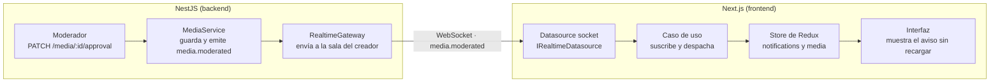
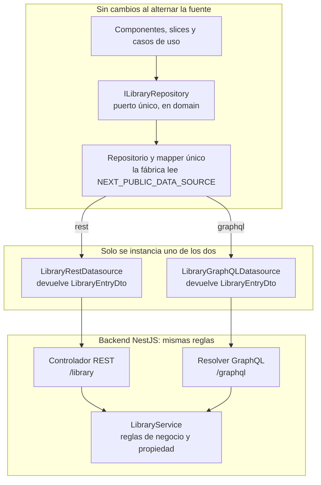

# **Taller: Nest JS y Next JS (Clean Architecture)**

**Proyecto:** Aplicación de gestión de librerías multimedia (juegos, películas y libros favoritos)

**Entrega:** Domingo, Octubre 11 de 2026

## **Objetivo**

Desarrollar una aplicación backend robusta con Nest JS, que utilice PostgreSQL para la persistencia de datos y pruebas unitarias, para la gestión de librerías multimedia.

Como ampliación, la aplicación incorpora notificaciones y estados en tiempo real mediante WebSockets, y un módulo de la API que también se expone con GraphQL. El cliente web (Next.js con Redux y arquitectura limpia) consume ambas funcionalidades.

## **Descripción del proyecto**

Actualmente, muchos usuarios llevan el registro de sus juegos, películas y libros favoritos o pendientes en notas sueltas, hojas de cálculo o aplicaciones independientes por cada tipo de medio, pero no existe una plataforma centralizada que permita organizar toda su colección, hacer seguimiento a su avance, calificar lo que consumen o compartir recomendaciones.

Por esta razón, se requiere una API que permita a los usuarios crear y administrar sus bibliotecas multimedia, registrar el estado y el progreso de cada título, organizar sus favoritos en listas personalizadas y consultar las reseñas de la comunidad, con moderación y administración según el rol.

## **1. Requisitos mínimos**

- **Seed (5%)**

  - Alimentar la base de datos con registros iniciales que permitan la realización de pruebas y el funcionamiento de la aplicación: los tres roles, un usuario de cada rol (administrador, moderador y usuario), al menos 10 géneros, al menos 5 elementos aprobados por cada tipo (juegos, películas y libros), bibliotecas de ejemplo para el usuario de prueba y al menos dos listas (una pública y una privada).

  - Usar un endpoint protegido (POST /seed, solo administrador) o un script (npm run seed) que permita el cargue inicial de los datos. El seed debe poder ejecutarse más de una vez sin duplicar registros.

- **Autenticación (7%)**

  - Implementar un sistema de autenticación basado en tokens JWT (Json Web Tokens), con registro e inicio de sesión con correo y contraseña. La contraseña se almacena cifrada con hash (bcrypt) y nunca se devuelve en las respuestas.

  - Los usuarios deben poder iniciar sesión y cerrar sesión. Al cerrar sesión el token se revoca y deja de ser válido aunque no haya expirado.

  - Debe haber rutas protegidas que requieran autenticación: todas las rutas, excepto el registro, el inicio de sesión y la documentación de Swagger.

- **Autorización (8%)**

  - Definir tres roles diferentes: usuario, moderador y administrador, con los permisos descritos en las secciones “Tipos de usuarios” y “Permisos por rol”.

  - Establecer los permisos basados en roles (guards y decoradores de Nest JS) para restringir el acceso a ciertas rutas o funcionalidades, y validar la propiedad de los recursos (un usuario solo puede modificar lo que le pertenece).

  - Los roles deben asignarse mediante un mecanismo de administración: el endpoint PATCH /users/:id/roles, disponible únicamente para administradores.

- **Pruebas (20%)**

  - Implementar pruebas unitarias (Jest) para los servicios principales: autenticación, catálogo, biblioteca personal, listas y reseñas, incluyendo las reglas de negocio descritas en “Funcionamiento de la biblioteca”.

  - Implementar pruebas de integración o extremo a extremo (supertest) para los flujos de registro, inicio y cierre de sesión, acceso a rutas protegidas y restricciones por rol (respuestas 401 y 403).

  - Cubrir con pruebas unitarias y e2e los componentes de las secciones 9 y 10: gateway, servicio de notificaciones, resolver de GraphQL y conexión WebSocket con y sin token.

- **Persistencia en base de datos (10%)**

  - Utilizar TypeORM para interactuar con una base de datos relacional PostgreSQL.

  - Modelar las entidades, enumeraciones, tipos de datos, restricciones y relaciones descritas en la sección “Modelo de datos”.

- **Funcionalidades (20%)**

  - Implementar en el backend las funcionalidades descritas en las secciones “Funcionamiento de la biblioteca” y “Endpoints de la API”.

  - Adjuntar el archivo json de Postman que permita ejecutar las pruebas de forma manual, con una colección organizada por módulo y variables de entorno para la URL base y el token.

- **Informe (10%)**

  - Preparar un informe detallado que describa las funcionalidades implementadas en la API.

  - El informe debe incluir una descripción de cada endpoint, sus parámetros y respuestas.

  - Además, debe explicar cómo se implementaron las características de autenticación, autorización y persistencia de la base de datos.

  - Incluir el catálogo de eventos de WebSocket y las operaciones GraphQL, con sus parámetros y respuestas (Swagger no los describe).

- **Despliegue (10%)**

  - Se debe desplegar la API y la base de datos PostgreSQL en algún servicio en nube, configurando las variables de entorno (conexión a la base de datos, secreto y expiración del JWT).

  - Para evitar consumir sus créditos, realice un video demostrando el despliegue del aplicativo y cierre el despliegue.

  - El proveedor en la nube debe aceptar conexiones WebSocket persistentes. Configurar también CORS_ORIGIN y las variables NEXT_PUBLIC_ del frontend (sección 8).

- **Swagger (5%)**

  - Agregar la documentación de Swagger en los endpoints (ruta /api/docs), incluyendo la descripción de los DTOs, los códigos de respuesta y la autenticación Bearer.

  - Los endpoints REST nuevos (notificaciones) se documentan igual; GraphQL y WebSocket se documentan en el README y en el informe.

- **Github Actions (5%)**

  - Agregar un pipeline de Github Actions que compruebe, al hacer un pull request y al hacer un push a la rama main, que las pruebas funcionen correctamente (instalación de dependencias, lint, pruebas unitarias y pruebas e2e con un servicio de PostgreSQL).

- **Tiempo real con WebSockets**

  - Incorporar al menos una funcionalidad reactiva en tiempo real (notificaciones, estados en vivo, chat o feed sincronizado). En este taller: el centro de notificaciones y estados en vivo descrito en la sección 9.

  - **DataSource Socket:** el cliente socket reside en `infrastructure/datasources/` bajo una interfaz de contrato.

  - **Handshake con JWT:** autenticar la conexión enviando el token JWT en el protocolo de enlace.

  - **Sincronización reactiva:** despachar los eventos entrantes directamente al store de Redux, sin requerir recargas de página.

- **Módulo dual: abstracción de datos REST y GraphQL**

  - Refactorizar un módulo completo (en este taller, Biblioteca personal) para operar indistintamente contra endpoints REST y GraphQL, según la sección 10:

  - **Puerto único:** una sola interfaz de repositorio en dominio para las operaciones requeridas.

  - **DataSources duales:** dos implementaciones (RestDatasource y GraphQLDatasource) que retornan los mismos DTOs hacia el mapper.

  - **Selección por configuración:** la fuente de datos activa se determina mediante la variable de entorno `NEXT_PUBLIC_DATA_SOURCE=rest|graphql`.

  - **Transparencia total:** cambiar la variable no altera casos de uso, entidades, slices de Redux ni componentes de la interfaz.

## **2. Tipos de usuarios**

La aplicación maneja tres roles almacenados en la base de datos, además del visitante que aún no ha iniciado sesión. Los permisos son acumulativos: el moderador incluye los del usuario y el administrador incluye los del moderador.

| **Tipo**               | **Descripción**                                                                                                       | **Cómo se obtiene**                                                             |
|------------------------|-----------------------------------------------------------------------------------------------------------------------|---------------------------------------------------------------------------------|
| Visitante (sin sesión) | Persona no autenticada. No es un rol almacenado en la base de datos.                                                  | Solo puede registrarse, iniciar sesión y consultar la documentación de Swagger. |
| Usuario (USER)         | Persona registrada que organiza su propia colección de juegos, películas y libros, escribe reseñas y comparte listas. | Rol por defecto al registrarse.                                                 |
| Moderador (MODERATOR)  | Tiene todos los permisos del usuario y además revisa los elementos propuestos al catálogo y las reseñas reportadas.   | Asignado por un administrador.                                                  |
| Administrador (ADMIN)  | Tiene todos los permisos del moderador y además gestiona usuarios, roles, géneros, catálogo y el seed.                | Creado en el seed; puede asignar roles a otros usuarios.                        |

## **3. Tipos de permisos**

Cada acción de la API se clasifica en uno de los siguientes tipos de permiso, y cada permiso tiene un alcance.

| **Tipo de permiso** | **Código** | **Descripción**                                                                          |
|---------------------|------------|------------------------------------------------------------------------------------------|
| Lectura             | read       | Consultar recursos (catálogo, biblioteca, listas, reseñas, estadísticas).                |
| Creación            | create     | Crear recursos nuevos (entradas de biblioteca, listas, reseñas, propuestas de catálogo). |
| Edición             | update     | Modificar recursos existentes.                                                           |
| Eliminación         | delete     | Borrar recursos.                                                                         |
| Moderación          | moderate   | Aprobar o rechazar elementos propuestos; ocultar o restaurar reseñas reportadas.         |
| Administración      | manage     | Gestionar usuarios, roles, géneros, catálogo completo y ejecutar el seed.                |

| **Alcance**      | **Descripción**                                                                                                                                                                     |
|------------------|-------------------------------------------------------------------------------------------------------------------------------------------------------------------------------------|
| Propio (own)     | El permiso aplica solo a los recursos cuyo dueño es el usuario autenticado. Se valida en el servicio comparando el id del usuario con el del recurso; si no coincide, responde 403. |
| Cualquiera (any) | El permiso aplica a los recursos de cualquier usuario. Se otorga solo mediante el rol (moderador o administrador).                                                                  |

## **4. Permisos por rol**

La siguiente matriz resume qué puede hacer cada rol. “Propio” indica que solo aplica a recursos del mismo usuario; “Sí” indica que aplica a los de cualquier usuario; “No” indica que la API responde 403.

| **Recurso**    | **Acción**                                                    | **Usuario** | **Moderador** | **Administrador** |
|----------------|---------------------------------------------------------------|-------------|---------------|-------------------|
| Cuenta         | Ver y editar su propio perfil                                 | Propio      | Propio        | Propio            |
| Usuarios       | Listar usuarios y ver el detalle de cualquiera                | No          | No            | Sí                |
| Usuarios       | Asignar roles y activar o desactivar cuentas                  | No          | No            | Sí                |
| Catálogo       | Consultar elementos aprobados                                 | Sí          | Sí            | Sí                |
| Catálogo       | Proponer un elemento personalizado (queda pendiente)          | Sí          | Sí            | Sí                |
| Catálogo       | Editar un elemento propio mientras esté pendiente             | Propio      | Propio        | Propio            |
| Catálogo       | Aprobar o rechazar elementos propuestos                       | No          | Sí            | Sí                |
| Catálogo       | Editar o eliminar cualquier elemento                          | No          | No            | Sí                |
| Géneros        | Consultar géneros                                             | Sí          | Sí            | Sí                |
| Géneros        | Crear, editar y eliminar géneros                              | No          | No            | Sí                |
| Biblioteca     | Agregar, editar y quitar entradas propias                     | Propio      | Propio        | Propio            |
| Biblioteca     | Ver la biblioteca de otro usuario                             | No          | No            | Sí                |
| Listas         | Crear, editar y eliminar listas propias                       | Propio      | Propio        | Propio            |
| Listas         | Consultar listas públicas de otros usuarios                   | Sí          | Sí            | Sí                |
| Reseñas        | Crear, editar y eliminar reseñas propias                      | Propio      | Propio        | Propio            |
| Reseñas        | Consultar reseñas visibles y reportar una reseña ajena        | Sí          | Sí            | Sí                |
| Reseñas        | Ver reportes; ocultar o restaurar reseñas                     | No          | Sí            | Sí                |
| Reseñas        | Eliminar cualquier reseña                                     | No          | No            | Sí                |
| Estadísticas   | Consultar sus propias estadísticas e historial                | Propio      | Propio        | Propio            |
| Estadísticas   | Consultar estadísticas globales de la plataforma              | No          | No            | Sí                |
| Notificaciones | Consultar y marcar como leídas las propias                    | Propio      | Propio        | Propio            |
| Tiempo real    | Conectarse al canal de eventos con el propio token            | Propio      | Propio        | Propio            |
| Tiempo real    | Recibir la cola de moderación en vivo (propuestas y reportes) | No          | Sí            | Sí                |
| Seed           | Ejecutar el cargue inicial de datos                           | No          | No            | Sí                |

## **5. Modelo de datos**

Se utiliza TypeORM sobre PostgreSQL. Todas las claves primarias son uuid. En las tablas siguientes, la columna “Tipo” indica el tipo en TypeScript y el tipo en la base de datos.

### **Enumeraciones**

| **Enumeración**  | **Valores**                                                                                                    |
|------------------|----------------------------------------------------------------------------------------------------------------|
| Role             | USER, MODERATOR, ADMIN                                                                                         |
| MediaType        | GAME, MOVIE, BOOK                                                                                              |
| ApprovalStatus   | PENDING, APPROVED, REJECTED                                                                                    |
| LibraryStatus    | PENDING (por ver, jugar o leer), IN_PROGRESS, COMPLETED, DROPPED                                               |
| ListVisibility   | PRIVATE, PUBLIC                                                                                                |
| ReportReason     | SPOILER, OFFENSIVE, SPAM, OTHER                                                                                |
| ReportStatus     | OPEN, RESOLVED, DISMISSED                                                                                      |
| ActivityAction   | ENTRY_ADDED, STATUS_CHANGED, PROGRESS_UPDATED, ENTRY_COMPLETED, FAVORITE_TOGGLED, REVIEW_CREATED, LIST_CREATED |
| NotificationType | MEDIA_MODERATED, REVIEW_VISIBILITY_CHANGED, ROLE_CHANGED                                                       |

### **User (users)**

| **Campo**            | **Tipo**              | **Restricciones y descripción**                                                                                           |
|----------------------|-----------------------|---------------------------------------------------------------------------------------------------------------------------|
| id                   | string / uuid         | Clave primaria generada automáticamente.                                                                                  |
| email                | string / varchar(120) | Obligatorio, único, con formato de correo válido.                                                                         |
| username             | string / varchar(30)  | Obligatorio, único, de 3 a 30 caracteres (letras, números y guion bajo).                                                  |
| password             | string / varchar(255) | Hash bcrypt. Mínimo 8 caracteres antes de cifrar, con mayúscula, minúscula y número. Nunca se devuelve en las respuestas. |
| fullName             | string / varchar(100) | Opcional.                                                                                                                 |
| role                 | Role / enum           | Por defecto USER.                                                                                                         |
| isActive             | boolean / boolean     | Por defecto true. Si es false no puede iniciar sesión.                                                                    |
| createdAt, updatedAt | Date / timestamp      | Generados automáticamente.                                                                                                |

### **Genre (genres)**

| **Campo**   | **Tipo**              | **Restricciones y descripción**                             |
|-------------|-----------------------|-------------------------------------------------------------|
| id          | string / uuid         | Clave primaria.                                             |
| name        | string / varchar(50)  | Obligatorio y único (por ejemplo: Acción, Drama, Fantasía). |
| description | string / varchar(255) | Opcional.                                                   |

### **MediaItem (media_items): elemento del catálogo**

| **Campo**            | **Tipo**               | **Restricciones y descripción**                                                   |
|----------------------|------------------------|-----------------------------------------------------------------------------------|
| id                   | string / uuid          | Clave primaria.                                                                   |
| title                | string / varchar(150)  | Obligatorio.                                                                      |
| type                 | MediaType / enum       | Obligatorio: GAME, MOVIE o BOOK.                                                  |
| description          | string / text          | Sinopsis. Opcional.                                                               |
| releaseYear          | number / integer       | Obligatorio, entre 1900 y el año actual + 5.                                      |
| creator              | string / varchar(120)  | Desarrollador (juego), director (película) o autor (libro).                       |
| coverUrl             | string / varchar(500)  | URL de la portada. Opcional.                                                      |
| platform             | string / varchar(60)   | Solo juegos (por ejemplo: PC, PlayStation). Opcional.                             |
| durationMinutes      | number / integer       | Solo películas. Mayor que 0. Es el máximo del progreso.                           |
| pages                | number / integer       | Solo libros. Mayor que 0. Es el máximo del progreso.                              |
| isbn                 | string / varchar(20)   | Solo libros. Opcional.                                                            |
| approvalStatus       | ApprovalStatus / enum  | APPROVED si lo crea el administrador o el seed; PENDING si lo propone un usuario. |
| rejectionReason      | string / varchar(255)  | Obligatorio cuando se rechaza un elemento.                                        |
| averageRating        | number / decimal(3,1)  | Promedio de las calificaciones personales (1 a 10). Por defecto 0.                |
| ratingsCount         | number / integer       | Cantidad de calificaciones. Por defecto 0.                                        |
| createdBy            | User / ManyToOne       | Usuario que creó o propuso el elemento.                                           |
| genres               | Genre\[\] / ManyToMany | Al menos un género.                                                               |
| createdAt, updatedAt | Date / timestamp       | Generados automáticamente. Restricción única: (title, type, releaseYear).         |

### **LibraryEntry (library_entries): elemento dentro de la biblioteca de un usuario**

| **Campo**              | **Tipo**              | **Restricciones y descripción**                                                                           |
|------------------------|-----------------------|-----------------------------------------------------------------------------------------------------------|
| id                     | string / uuid         | Clave primaria.                                                                                           |
| user                   | User / ManyToOne      | Dueño de la entrada. Si se elimina el usuario, se eliminan sus entradas.                                  |
| mediaItem              | MediaItem / ManyToOne | Elemento del catálogo. Restricción única: (user, mediaItem).                                              |
| status                 | LibraryStatus / enum  | Por defecto PENDING.                                                                                      |
| progress               | number / integer      | Por defecto 0, nunca negativo. Páginas leídas (libro), minutos vistos (película) u horas jugadas (juego). |
| rating                 | number / smallint     | Calificación personal entera de 1 a 10. Nulo si no ha calificado.                                         |
| isFavorite             | boolean / boolean     | Por defecto false.                                                                                        |
| notes                  | string / text         | Notas privadas del usuario. Opcional.                                                                     |
| startedAt, completedAt | Date / date           | Nulos hasta que el estado lo determine (ver reglas).                                                      |
| addedAt, updatedAt     | Date / timestamp      | Generados automáticamente.                                                                                |

### **UserList (user_lists): lista personalizada**

| **Campo**            | **Tipo**                   | **Restricciones y descripción**                             |
|----------------------|----------------------------|-------------------------------------------------------------|
| id                   | string / uuid              | Clave primaria.                                             |
| name                 | string / varchar(80)       | Obligatorio. Único por dueño.                               |
| description          | string / varchar(255)      | Opcional.                                                   |
| visibility           | ListVisibility / enum      | Por defecto PRIVATE.                                        |
| owner                | User / ManyToOne           | Dueño de la lista.                                          |
| items                | MediaItem\[\] / ManyToMany | Tabla intermedia list_items. No admite elementos repetidos. |
| createdAt, updatedAt | Date / timestamp           | Generados automáticamente.                                  |

### **Review (reviews)**

| **Campo**            | **Tipo**              | **Restricciones y descripción**                                              |
|----------------------|-----------------------|------------------------------------------------------------------------------|
| id                   | string / uuid         | Clave primaria.                                                              |
| user                 | User / ManyToOne      | Autor de la reseña.                                                          |
| mediaItem            | MediaItem / ManyToOne | Elemento reseñado. Restricción única: (user, mediaItem).                     |
| title                | string / varchar(100) | Opcional.                                                                    |
| content              | string / text         | Obligatorio, de 10 a 2000 caracteres.                                        |
| isHidden             | boolean / boolean     | Por defecto false. Una reseña oculta solo la ven su autor y los moderadores. |
| hiddenReason         | string / varchar(255) | Motivo de ocultamiento. Opcional.                                            |
| createdAt, updatedAt | Date / timestamp      | Generados automáticamente.                                                   |

### **ReviewReport (review_reports)**

| **Campo**             | **Tipo**              | **Restricciones y descripción**                         |
|-----------------------|-----------------------|---------------------------------------------------------|
| id                    | string / uuid         | Clave primaria.                                         |
| review                | Review / ManyToOne    | Reseña reportada.                                       |
| reportedBy            | User / ManyToOne      | Quien reporta. Restricción única: (review, reportedBy). |
| reason                | ReportReason / enum   | Obligatorio.                                            |
| comment               | string / varchar(255) | Opcional.                                               |
| status                | ReportStatus / enum   | Por defecto OPEN.                                       |
| resolvedBy            | User / ManyToOne      | Moderador que resolvió. Nulo mientras esté abierto.     |
| createdAt, resolvedAt | Date / timestamp      | resolvedAt es nulo mientras esté abierto.               |

### **ActivityLog (activity_logs): historial de actividad**

| **Campo** | **Tipo**              | **Restricciones y descripción**                                     |
|-----------|-----------------------|---------------------------------------------------------------------|
| id        | string / uuid         | Clave primaria.                                                     |
| user      | User / ManyToOne      | Usuario que realizó la acción.                                      |
| action    | ActivityAction / enum | Tipo de acción registrada.                                          |
| mediaItem | MediaItem / ManyToOne | Elemento involucrado. Opcional.                                     |
| metadata  | object / jsonb        | Datos adicionales (por ejemplo: estado anterior y nuevo). Opcional. |
| createdAt | Date / timestamp      | Generado automáticamente.                                           |

### **RevokedToken (revoked_tokens): tokens cerrados con logout**

| **Campo** | **Tipo**             | **Restricciones y descripción**                                    |
|-----------|----------------------|--------------------------------------------------------------------|
| id        | string / uuid        | Clave primaria.                                                    |
| jti       | string / varchar(64) | Identificador único del token JWT. Único.                          |
| expiresAt | Date / timestamp     | Fecha de expiración del token; permite limpiar registros vencidos. |
| revokedAt | Date / timestamp     | Fecha del cierre de sesión.                                        |

### **Notification (notifications): notificaciones del usuario**

Se usa para no perder avisos enviados mientras el usuario está desconectado (sección 9).

| **Campo** | **Tipo**                | **Restricciones y descripción**                                                   |
|-----------|-------------------------|-----------------------------------------------------------------------------------|
| id        | string / uuid           | Clave primaria.                                                                   |
| user      | User / ManyToOne        | Destinatario. Si se elimina el usuario, se eliminan sus notificaciones.           |
| type      | NotificationType / enum | Obligatorio.                                                                      |
| payload   | object / jsonb          | Datos del evento (por ejemplo: mediaItemId, estado, motivo). Sin datos sensibles. |
| isRead    | boolean / boolean       | Por defecto false.                                                                |
| createdAt | Date / timestamp        | Generado automáticamente.                                                         |

## **Relaciones principales**

- User 1 — N LibraryEntry, UserList, Review, ReviewReport, ActivityLog y Notification.

- MediaItem 1 — N LibraryEntry y Review; MediaItem N — M Genre; MediaItem N — M UserList.

- Review 1 — N ReviewReport.

- User 1 — N MediaItem (createdBy).

## **6. Funcionamiento de la biblioteca**

Estas reglas de negocio deben implementarse en los servicios y estar cubiertas por pruebas unitarias.

1. **Colección unificada.** Cada usuario tiene una única biblioteca que agrupa juegos, películas y libros. El tipo de cada entrada lo determina el elemento del catálogo (MediaItem.type).

2. **Agregar elementos.** Solo se pueden agregar elementos con approvalStatus APPROVED o elementos propuestos por el mismo usuario. Un elemento no puede agregarse dos veces a la misma biblioteca (error 409). La entrada nace con status PENDING y progress 0, salvo que se indique otro estado.

3. **Estados.** Una entrada puede cambiar libremente entre PENDING, IN_PROGRESS, COMPLETED y DROPPED, aplicando automáticamente estas reglas: al pasar a IN_PROGRESS por primera vez se guarda startedAt; al pasar a COMPLETED se guarda completedAt y, si el elemento tiene máximo (páginas o minutos), el progreso se iguala a ese máximo; al salir de COMPLETED se borra completedAt.

4. **Progreso.** La unidad depende del tipo: páginas leídas en libros (máximo: pages), minutos vistos en películas (máximo: durationMinutes) y horas jugadas en juegos (sin máximo). El progreso no puede ser negativo ni superar el máximo (error 400). Si el progreso es mayor que 0 y el estado es PENDING, pasa automáticamente a IN_PROGRESS; si en libros o películas alcanza el máximo, pasa automáticamente a COMPLETED.

5. **Calificación personal.** Es un número entero de 1 a 10 y solo puede asignarse cuando el estado es IN_PROGRESS, COMPLETED o DROPPED (error 400 si está PENDING). Al crear, cambiar o quitar una calificación, o al eliminar la entrada, se recalculan averageRating y ratingsCount del elemento.

6. **Favoritos.** Se marcan o desmarcan con el campo isFavorite de la entrada y se pueden filtrar en la consulta de la biblioteca.

7. **Listas personalizadas.** El usuario crea listas con nombre único y visibilidad PRIVATE o PUBLIC. Solo se pueden agregar elementos aprobados y sin repetir. Las listas públicas las pueden consultar todos los usuarios autenticados, mostrando el nombre de usuario del dueño; las privadas solo las ve su dueño.

8. **Elementos personalizados.** Si el elemento que busca el usuario no existe, puede proponerlo. Queda en estado PENDING, visible solo para su creador (que puede agregarlo a su biblioteca) hasta que un moderador lo apruebe o lo rechace con un motivo. Un elemento rechazado no aparece en el catálogo, pero la entrada ya creada en la biblioteca se conserva.

9. **Reseñas.** Un usuario puede escribir una sola reseña por elemento y solo si lo tiene en su biblioteca con estado IN_PROGRESS, COMPLETED o DROPPED. Puede editarla o eliminarla.

10. **Reportes y moderación.** Cualquier usuario puede reportar una reseña ajena con un motivo (una sola vez por reseña). La reseña sigue visible hasta que un moderador resuelve el reporte: HIDE oculta la reseña (isHidden = true) y marca el reporte como RESOLVED; DISMISS lo marca como DISMISSED y deja la reseña visible.

11. **Eliminación y desactivación.** Quitar un elemento de la biblioteca no elimina el elemento del catálogo ni las reseñas del usuario. Un administrador no elimina usuarios: los desactiva (isActive = false), lo que bloquea el inicio de sesión y conserva sus datos.

12. **Historial.** Cada acción relevante (agregar elemento, cambiar estado, actualizar progreso, completar, marcar favorito, crear reseña o lista) genera automáticamente un registro en ActivityLog, que el usuario consulta en GET /activity.

13. **Estadísticas personales.** GET /stats/me devuelve: total de entradas por tipo, total por estado, los 5 géneros más frecuentes, elementos completados por mes en los últimos 12 meses y la calificación promedio otorgada.

14. **Notificaciones en tiempo real.** Las decisiones de moderación sobre un elemento propuesto, la ocultación de una reseña y los cambios de rol o de estado de cuenta generan un evento para el usuario afectado. Se entrega por WebSocket si está conectado y se guarda como notificación para consultarla después (sección 9).

## **Filtros, orden y paginación**

Las consultas de listado (catálogo, biblioteca, usuarios, listas públicas, reseñas, historial y notificaciones) aceptan los siguientes parámetros de consulta, según corresponda, y responden con la estructura { data: \[\], meta: { total, page, limit, totalPages } }.

| **Parámetro** | **Tipo**      | **Descripción**                                                                |
|---------------|---------------|--------------------------------------------------------------------------------|
| q             | string        | Busca por texto en el título o el creador.                                     |
| type          | MediaType     | Filtra por juego, película o libro.                                            |
| genreId       | uuid          | Filtra por género.                                                             |
| year          | integer       | Filtra por año de lanzamiento.                                                 |
| status        | LibraryStatus | Solo en /library: filtra por estado.                                           |
| isFavorite    | boolean       | Solo en /library: filtra favoritos.                                            |
| isRead        | boolean       | Solo en /notifications: filtra notificaciones leídas o no leídas.              |
| sortBy        | string        | Campo de orden: title, releaseYear, averageRating o addedAt (solo biblioteca). |
| order         | ASC \| DESC   | Sentido del orden. Por defecto ASC.                                            |
| page          | integer       | Número de página, desde 1. Por defecto 1.                                      |
| limit         | integer       | Elementos por página, de 1 a 50. Por defecto 10.                               |

## **7. Endpoints de la API**

Todas las rutas, excepto el registro y el inicio de sesión, requieren el encabezado Authorization: Bearer \<token\>. La columna “Rol mínimo” indica el rol más bajo con acceso. La conexión WebSocket envía el token en el handshake en lugar del encabezado.

| **Método**                         | **Ruta**                      | **Rol mínimo**          | **Descripción**                                                                                                                   |
|------------------------------------|-------------------------------|-------------------------|-----------------------------------------------------------------------------------------------------------------------------------|
| **Autenticación**                  |                               |                         |                                                                                                                                   |
| POST                               | /auth/register                | Visitante               | Crea un usuario con rol USER. Body: email, username, password, fullName (opcional).                                               |
| POST                               | /auth/login                   | Visitante               | Body: email, password. Devuelve accessToken (JWT, expira en 1 hora) y los datos básicos del usuario.                              |
| POST                               | /auth/logout                  | Usuario                 | Revoca el token actual.                                                                                                           |
| GET                                | /auth/me                      | Usuario                 | Devuelve el perfil del usuario autenticado.                                                                                       |
| **Usuarios**                       |                               |                         |                                                                                                                                   |
| PATCH                              | /users/me                     | Usuario                 | Edita el perfil propio (username, fullName, password).                                                                            |
| GET                                | /users                        | Administrador           | Lista paginada. Filtros: role, isActive, q.                                                                                       |
| GET                                | /users/:id                    | Administrador           | Detalle de un usuario.                                                                                                            |
| PATCH                              | /users/:id/roles              | Administrador           | Body: role. Asigna un rol.                                                                                                        |
| PATCH                              | /users/:id/status             | Administrador           | Body: isActive. Activa o desactiva la cuenta.                                                                                     |
| **Géneros**                        |                               |                         |                                                                                                                                   |
| GET                                | /genres                       | Usuario                 | Lista todos los géneros.                                                                                                          |
| POST, PATCH, DELETE                | /genres, /genres/:id          | Administrador           | Crea, edita o elimina un género. Eliminar uno en uso responde 409.                                                                |
| **Catálogo**                       |                               |                         |                                                                                                                                   |
| GET                                | /media                        | Usuario                 | Elementos aprobados con filtros y paginación. Incluye los propios pendientes.                                                     |
| GET                                | /media/:id                    | Usuario                 | Detalle con géneros, promedio y cantidad de calificaciones.                                                                       |
| POST                               | /media                        | Usuario                 | Propone un elemento. Queda PENDING (APPROVED si lo crea un administrador).                                                        |
| PATCH                              | /media/:id                    | Usuario / Administrador | El creador edita mientras esté PENDING; el administrador edita siempre.                                                           |
| DELETE                             | /media/:id                    | Administrador           | Elimina un elemento del catálogo.                                                                                                 |
| GET                                | /media/pending                | Moderador               | Lista los elementos pendientes de aprobación.                                                                                     |
| PATCH                              | /media/:id/approval           | Moderador               | Body: approvalStatus (APPROVED o REJECTED) y rejectionReason si se rechaza.                                                       |
| **Biblioteca personal**            |                               |                         |                                                                                                                                   |
| GET                                | /library                      | Usuario                 | Biblioteca propia con filtros y paginación.                                                                                       |
| POST                               | /library                      | Usuario                 | Body: mediaItemId, status (opcional). Agrega un elemento; 409 si ya existe.                                                       |
| GET                                | /library/:id                  | Usuario                 | Detalle de una entrada propia.                                                                                                    |
| PATCH                              | /library/:id                  | Usuario                 | Body (todos opcionales): status, progress, rating, isFavorite, notes.                                                             |
| DELETE                             | /library/:id                  | Usuario                 | Quita la entrada de la biblioteca.                                                                                                |
| **Listas**                         |                               |                         |                                                                                                                                   |
| GET                                | /lists                        | Usuario                 | Listas propias.                                                                                                                   |
| GET                                | /lists/public                 | Usuario                 | Listas públicas de otros usuarios (paginado).                                                                                     |
| POST                               | /lists                        | Usuario                 | Body: name, description, visibility.                                                                                              |
| GET                                | /lists/:id                    | Usuario                 | Detalle; una lista privada solo la ve su dueño.                                                                                   |
| PATCH, DELETE                      | /lists/:id                    | Usuario                 | Edita o elimina una lista propia.                                                                                                 |
| POST                               | /lists/:id/items              | Usuario                 | Body: mediaItemId. Agrega un elemento aprobado a la lista.                                                                        |
| DELETE                             | /lists/:id/items/:mediaItemId | Usuario                 | Quita un elemento de la lista.                                                                                                    |
| **Reseñas y moderación**           |                               |                         |                                                                                                                                   |
| GET                                | /media/:id/reviews            | Usuario                 | Reseñas visibles del elemento (paginado).                                                                                         |
| POST                               | /media/:id/reviews            | Usuario                 | Body: title, content. Requiere tener el elemento en la biblioteca.                                                                |
| PATCH, DELETE                      | /reviews/:id                  | Usuario / Administrador | Edita o elimina la reseña propia; el administrador puede eliminar cualquiera.                                                     |
| POST                               | /reviews/:id/report           | Usuario                 | Body: reason, comment. 409 si ya la reportó.                                                                                      |
| GET                                | /reports                      | Moderador               | Reportes filtrados por status.                                                                                                    |
| PATCH                              | /reports/:id/resolve          | Moderador               | Body: action (HIDE o DISMISS) y reason si se oculta.                                                                              |
| **Estadísticas, historial y seed** |                               |                         |                                                                                                                                   |
| GET                                | /stats/me                     | Usuario                 | Estadísticas propias (ver “Funcionamiento de la biblioteca”).                                                                     |
| GET                                | /stats/global                 | Administrador           | Totales de usuarios, elementos por tipo, entradas y reseñas.                                                                      |
| GET                                | /activity                     | Usuario                 | Historial propio, paginado, más reciente primero.                                                                                 |
| POST                               | /seed                         | Administrador           | Ejecuta el cargue inicial de datos.                                                                                               |
| **Notificaciones y tiempo real**   |                               |                         |                                                                                                                                   |
| GET                                | /notifications                | Usuario                 | Notificaciones propias, paginado, más reciente primero. Filtro: isRead.                                                           |
| PATCH                              | /notifications/:id/read       | Usuario                 | Marca una notificación propia como leída.                                                                                         |
| WS                                 | /socket.io                    | Usuario                 | Conexión en tiempo real (Socket.IO). El JWT viaja en auth.token del handshake. Eventos en la sección 9.                           |
| **GraphQL (módulo Biblioteca)**    |                               |                         |                                                                                                                                   |
| POST                               | /graphql                      | Usuario                 | Consultas y mutaciones de Biblioteca: myLibrary, libraryEntry, addToLibrary, updateLibraryEntry, removeLibraryEntry (sección 10). |

## **Códigos de respuesta**

| **Código**      | **Uso**                                                                                       |
|-----------------|-----------------------------------------------------------------------------------------------|
| 200 / 201 / 204 | Operación exitosa / recurso creado / exitosa sin contenido.                                   |
| 400             | Datos inválidos: falla la validación del DTO o una regla de negocio (progreso, calificación). |
| 401             | Falta el token, es inválido, expiró o fue revocado.                                           |
| 403             | El rol o la propiedad del recurso no permite la acción.                                       |
| 404             | El recurso no existe o no es visible para el usuario.                                         |
| 409             | Conflicto: duplicado (correo, entrada de biblioteca, reporte) o recurso en uso.               |

En GraphQL los mismos códigos se devuelven en `extensions.status` y `extensions.code` (sección 10).

## **8. Requisitos técnicos**

- Arquitectura modular de Nest JS: módulos auth, users, genres, media, library, lists, reviews, reports, stats, activity y seed, más los módulos notifications y realtime. GraphQL se configura con GraphQLModule en AppModule y el LibraryResolver pertenece al módulo library.

- Validación de entradas con DTOs, class-validator y ValidationPipe global con whitelist activado.

- Configuración mediante variables de entorno (ConfigModule): conexión a PostgreSQL, secreto y expiración del JWT. El archivo .env no se sube al repositorio; se incluye un .env.example.

- Contraseñas cifradas con bcrypt y nunca expuestas en las respuestas; tokens JWT con identificador único (jti) para poder revocarlos.

- Manejo consistente de errores con las excepciones HTTP de Nest JS y los códigos de la sección anterior.

- Guards (JwtAuthGuard y RolesGuard) que funcionen en los tres contextos de ejecución: HTTP, GraphQL (GqlExecutionContext) y WebSocket (client.handshake). El rol vigente se lee de la base de datos, no del token.

- Dependencias de las ampliaciones: @nestjs/websockets, @nestjs/platform-socket.io, @nestjs/event-emitter, @nestjs/graphql, @nestjs/apollo, @apollo/server y graphql.

- Variables de entorno adicionales. Backend: CORS_ORIGIN (origen del frontend, para HTTP y WebSocket) y GRAPHQL_INTROSPECTION (false en producción). Frontend: NEXT_PUBLIC_API_URL, NEXT_PUBLIC_GRAPHQL_URL, NEXT_PUBLIC_WS_URL y NEXT_PUBLIC_DATA_SOURCE. Se actualiza el .env.example.

## **9. Tiempo real con WebSockets**

Con REST, el usuario se entera de una decisión ajena solo si recarga la página o si el cliente consulta la API cada pocos segundos. Esta sección define un centro de notificaciones y estados en vivo para los casos en que el resultado depende de otra persona (un moderador o un administrador).

**Tecnología.** Socket.IO sobre `@nestjs/websockets` en el backend y `socket.io-client` en el frontend. Permite enviar el JWT en el handshake (`auth.token`) sin ponerlo en la URL, y ofrece salas y reconexión automática.

### **Situaciones que lo justifican**

| **Situación (regla del taller)**                                                            | **Quién espera**          | **Con REST**                                                                         | **Con WebSocket**                                                                                   |
|---------------------------------------------------------------------------------------------|---------------------------|--------------------------------------------------------------------------------------|-----------------------------------------------------------------------------------------------------|
| Un elemento propuesto queda `PENDING` hasta que un moderador lo apruebe o rechace (regla 8) | Usuario proponente        | Debe recargar `GET /media` para saber si fue aprobado o por qué se rechazó           | Aviso inmediato con el estado y el `rejectionReason`; el elemento pasa a ser visible en el catálogo |
| Cola de elementos pendientes y reportes abiertos (`GET /media/pending`, `GET /reports`)     | Moderador y administrador | Debe consultar la cola a mano o por polling                                          | Contadores y lista se actualizan cuando llega una propuesta o un reporte                            |
| Una reseña es ocultada por un moderador (regla 10)                                          | Autor de la reseña        | Se entera solo al volver a abrir el elemento                                         | Notificación con el motivo del ocultamiento                                                         |
| Cambio de rol o desactivación de cuenta (regla 11; `PATCH /users/:id/roles` y `/status`)    | Usuario afectado          | La interfaz sigue mostrando permisos viejos hasta recargar o volver a iniciar sesión | La interfaz se ajusta al instante; la desactivación cierra la sesión                                |

Hay una quinta situación, opcional: cada cambio de calificación recalcula `averageRating` y `ratingsCount` (regla 5), y quien tiene abierto el detalle de ese elemento puede verlos cambiar en vivo.

El mínimo para cumplir el requisito son las dos primeras filas. Las demás son ampliaciones de bajo costo: reutilizan la misma conexión y el mismo patrón de eventos.

### **Requerimientos funcionales**

Doce requerimientos cubren el requisito de tiempo real. La columna Prioridad indica cuáles son indispensables (Mínimo) y cuáles amplían la funcionalidad (Recomendado y Extra).

| **ID**   | **Requerimiento**                                                                                                                                                                                                          | **Prioridad** |
|----------|----------------------------------------------------------------------------------------------------------------------------------------------------------------------------------------------------------------------------|---------------|
| RF-WS-01 | El cliente abre la conexión enviando el JWT en el handshake (`auth.token`). El servidor valida firma, expiración, `jti` no revocado y `isActive = true`; si algo falla, rechaza la conexión con un error de autenticación. | Mínimo        |
| RF-WS-02 | El servidor decide las salas de cada socket: `user:{id}` para todos y `moderators` para moderadores y administradores. El cliente no puede pedir salas ajenas.                                                             | Mínimo        |
| RF-WS-03 | Al aprobar o rechazar un elemento, su creador recibe `media.moderated` con el nuevo estado y el motivo si fue rechazado.                                                                                                   | Mínimo        |
| RF-WS-04 | Al proponerse un elemento, crearse un reporte o resolverse alguno de ellos, la sala `moderators` recibe `moderation.queue.changed` con los totales actualizados.                                                           | Mínimo        |
| RF-WS-05 | Al ocultar una reseña (y al restaurarla, si se implementa esa acción), su autor recibe `review.visibility.changed` con el motivo.                                                                                          | Recomendado   |
| RF-WS-06 | Al cambiar el rol de un usuario este recibe `account.updated`; al desactivarlo recibe `account.deactivated` y el servidor cierra sus sockets.                                                                              | Recomendado   |
| RF-WS-07 | Al cerrar sesión (`POST /auth/logout`) el servidor desconecta los sockets de ese token; cuando el JWT expira, también.                                                                                                     | Recomendado   |
| RF-WS-08 | Las notificaciones se guardan en la tabla `notifications` y se consultan al conectar (`GET /notifications`), para no perder avisos enviados con el usuario desconectado.                                                   | Recomendado   |
| RF-WS-09 | El cliente socket vive en `infrastructure/datasources/` y se usa solo a través de una interfaz (`IRealtimeDatasource`: `connect(token)`, `disconnect()`, `on(evento, handler)`, `off(evento)`).                            | Mínimo        |
| RF-WS-10 | Un caso de uso suscribe los eventos entrantes y cada uno se despacha como acción de Redux, de modo que la interfaz cambia sin recargar la página.                                                                          | Mínimo        |
| RF-WS-11 | El store guarda el estado de la conexión (`connecting`, `connected`, `reconnecting`, `disconnected`) y la interfaz lo muestra.                                                                                             | Recomendado   |
| RF-WS-12 | Las calificaciones y reseñas nuevas se reflejan en vivo en el detalle de un elemento, mediante la sala `media:{id}`.                                                                                                       | Extra         |

### **Requerimientos no funcionales**

| **ID**    | **Requerimiento**                                                                                                                                                                                |
|-----------|--------------------------------------------------------------------------------------------------------------------------------------------------------------------------------------------------|
| RNF-WS-01 | El token no viaja en la URL ni en parámetros de consulta; solo en `auth` del handshake.                                                                                                          |
| RNF-WS-02 | Los payloads llevan solo identificadores y campos que el destinatario ya puede ver; nunca correo, contraseña ni datos de otros usuarios.                                                         |
| RNF-WS-03 | Los servicios de dominio emiten eventos internos (`@nestjs/event-emitter`) después de guardar en base de datos y no conocen el gateway. Si la operación falla, no se emite nada.                 |
| RNF-WS-04 | Tras una caída de red el cliente se reconecta con espera creciente y recupera lo perdido consultando `GET /notifications` (requiere RF-WS-08).                                                   |
| RNF-WS-05 | El despliegue en la nube debe aceptar conexiones persistentes y tener CORS configurado para el origen del frontend. Con una sola instancia no hace falta un adaptador adicional; con varias, sí. |
| RNF-WS-06 | Pruebas unitarias (Jest) del gateway y del servicio de notificaciones, y e2e con `socket.io-client`: sin token, con token revocado y con usuario inactivo la conexión se rechaza.                |
| RNF-WS-07 | El datasource socket se prueba en el frontend con un doble de la interfaz; ningún componente ni slice importa `socket.io-client`.                                                                |

### **Casos de uso**

Seis casos de uso describen el canal completo, desde conectarse hasta cerrar sesión. Los casos 02 y 03 son los que demuestran el requisito en una sustentación.

#### **CU-WS-01 · Conectarse al canal en tiempo real**

- **Actores:** Usuario, Moderador, Administrador.
- **Precondición:** sesión iniciada con un JWT vigente.

**Flujo principal**

1. Tras el login, el frontend ejecuta `ConnectRealtimeUseCase` con el token.
2. El datasource socket abre la conexión con `auth: { token }`.
3. El gateway valida firma, expiración, `jti` y `isActive`.
4. El servidor une el socket a `user:{id}` y, si el rol es moderador o administrador, a `moderators`.
5. El cliente despacha `realtime/connected` y el store guarda el estado.

**Alternos**

- Token ausente, inválido, expirado o revocado, o usuario inactivo: el servidor rechaza la conexión, el cliente despacha `realtime/error` y cierra la sesión local.
- Caída de red: reconexión automática y recuperación de notificaciones (RF-WS-08).

**Postcondición:** un socket autenticado por sesión, sin salas ajenas.

#### **CU-WS-02 · Recibir el resultado de moderación de un elemento propuesto**

- **Actores:** Usuario (proponente) y Moderador.
- **Precondición:** el elemento está `PENDING` y el proponente tiene el socket conectado.

**Flujo principal**

1. El moderador envía `PATCH /media/:id/approval` con `APPROVED`, o con `REJECTED` y `rejectionReason`.
2. `MediaService` guarda el estado y emite el evento interno `media.moderated`.
3. El gateway envía `media.moderated` a la sala `user:{creatorId}`.
4. El datasource entrega el evento al caso de uso, que lo despacha a Redux.
5. El slice `notifications` agrega el aviso y el slice del catálogo actualiza `approvalStatus`; la interfaz cambia sin recargar.

**Alternos**

- Rechazo sin motivo: responde 400 y no se emite nada.
- Proponente desconectado: la notificación queda guardada y la recibe al reconectar.
- Un elemento rechazado desaparece del catálogo, pero la entrada ya creada en la biblioteca se conserva (regla 8).

**Postcondición:** el estado está persistido antes de emitir el evento.

#### **CU-WS-03 · Seguir la cola de moderación en vivo**

- **Actores:** Moderador, Administrador.
- **Precondición:** socket conectado y unido a la sala `moderators`.

**Flujo principal**

1. Un usuario propone un elemento (`POST /media`) o reporta una reseña (`POST /reviews/:id/report`).
2. El servicio guarda el registro y emite `moderation.queue.changed` con `kind` (`MEDIA` o `REPORT`) y los totales de pendientes y reportes abiertos.
3. El gateway lo envía a la sala `moderators`.
4. El slice `moderation` actualiza contadores y lista, y la interfaz resalta el ítem nuevo.

**Alternos**

- Si otro moderador ya resolvió el ítem, el evento de resolución lo retira de la lista del segundo.

**Postcondición:** todos los moderadores conectados ven los mismos totales.

#### **CU-WS-04 · Enterarse de que una reseña propia fue ocultada**

- **Actores:** Usuario (autor) y Moderador.
- **Precondición:** existe un reporte `OPEN` sobre la reseña.

**Flujo principal**

1. El moderador envía `PATCH /reports/:id/resolve` con `HIDE` y `reason`.
2. `ReportsService` marca la reseña con `isHidden = true`, el reporte como `RESOLVED` y emite `review.visibility.changed`.
3. El autor recibe el evento; Redux marca la reseña como oculta y agrega una notificación con el `hiddenReason`.

**Alternos**

- Con `DISMISS` la reseña sigue visible y no se notifica al autor.

#### **CU-WS-05 · Ajustarse a un cambio de rol o a la desactivación de la cuenta**

- **Actores:** Administrador y Usuario afectado.
- **Precondición:** el usuario afectado tiene una sesión abierta.

**Flujo principal**

1. El administrador envía `PATCH /users/:id/roles` con `role`, o `PATCH /users/:id/status` con `isActive: false`.
2. `UsersService` guarda el cambio y emite `account.updated` o `account.deactivated`.
3. El gateway lo envía a `user:{id}`; en la desactivación, además cierra los sockets del usuario.
4. Con `account.updated`, el cliente consulta `GET /auth/me` y actualiza el slice de autenticación, de modo que menús y rutas siguen el rol vigente.
5. Con `account.deactivated`, el cliente borra el token y redirige al login.

**Alternos**

- Si el JWT trae el rol antiguo, `RolesGuard` lee el rol vigente desde la base de datos (ver “Decisiones de diseño” en esta sección).

**Postcondición:** la interfaz refleja el rol vigente sin que el usuario inicie sesión de nuevo.

#### **CU-WS-06 · Cerrar sesión y cortar el canal**

- **Actores:** cualquier usuario autenticado.

**Flujo principal**

1. El usuario ejecuta `POST /auth/logout`; el servicio guarda el `jti` en `revoked_tokens`.
2. El gateway desconecta los sockets asociados a ese `jti`.
3. El cliente ejecuta `DisconnectRealtimeUseCase` y vacía el estado de notificaciones.

**Alternos**

- Si el JWT expira (1 hora) con la conexión abierta, el servidor cierra el socket al vencer y el cliente redirige al login.

### **Catálogo de eventos**

Un evento nace en un servicio de Nest JS, viaja por el gateway a una sala y termina como una acción de Redux. El catálogo fija el nombre, el destinatario y el efecto de cada evento.

| **Evento (servidor al cliente)** | **Lo dispara**                                                                    | **Sala destino**      | **Payload**                                                 | **Efecto en Redux**                                |
|----------------------------------|-----------------------------------------------------------------------------------|-----------------------|-------------------------------------------------------------|----------------------------------------------------|
| `media.moderated`                | `PATCH /media/:id/approval`                                                       | `user:{creatorId}`    | `mediaItemId`, `title`, `approvalStatus`, `rejectionReason` | `notifications/added`; `media/approvalChanged`     |
| `moderation.queue.changed`       | `POST /media` (no administrador), `POST /reviews/:id/report`, resolución de ambos | `moderators`          | `kind`, `pendingMedia`, `openReports`                       | `moderation/countsUpdated`                         |
| `review.visibility.changed`      | `PATCH /reports/:id/resolve` con `HIDE`                                           | `user:{authorId}`     | `reviewId`, `mediaItemId`, `isHidden`, `hiddenReason`       | `notifications/added`; `reviews/visibilityChanged` |
| `account.updated`                | `PATCH /users/:id/roles`                                                          | `user:{id}`           | `role`                                                      | `auth/roleChanged` (vuelve a leer `GET /auth/me`)  |
| `account.deactivated`            | `PATCH /users/:id/status` con `isActive: false`                                   | `user:{id}`           | sin datos                                                   | `auth/forcedLogout`                                |
| `media.rating.updated` (extra)   | `PATCH` o `DELETE /library/:id` que cambia la calificación                        | `media:{mediaItemId}` | `mediaItemId`, `averageRating`, `ratingsCount`              | `media/ratingUpdated`                              |
| `review.created` (extra)         | `POST /media/:id/reviews`                                                         | `media:{mediaItemId}` | `reviewId`, `title`, `username`                             | `reviews/added`                                    |

Eventos del cliente al servidor: solo `media.subscribe` y `media.unsubscribe` con `mediaItemId`, y únicamente para el extra RF-WS-12. El servidor valida que el elemento sea visible para ese usuario antes de unirlo a la sala.

### **Flujo de un evento**



El servicio guarda primero y emite después; el gateway solo reenvía el evento a la sala, y el cliente lo trata como cualquier otra acción de Redux.

### **Decisiones de diseño**

- **Rol vigente.** `RolesGuard` lee el rol desde la base de datos en cada petición, no del token. Así un cambio de rol surte efecto sin un nuevo login.
- **Notificaciones persistidas.** Se implementa RF-WS-08: entidad `Notification` (sección 5) y los endpoints `GET /notifications` y `PATCH /notifications/:id/read` (sección 7). Evita perder avisos con el usuario desconectado y sostiene la reconexión (RNF-WS-04).
- **Restauración de reseñas.** La sección 7 solo define `HIDE` y `DISMISS`. Por eso `review.visibility.changed` cubre el ocultamiento; si se agrega un endpoint para restaurar, emite el mismo evento con `isHidden: false`.

### **Criterios de aceptación**

| **Criterio**                          | **Requerimientos**             | **Casos de uso**   | **Cómo se comprueba**                                                                                                                   |
|---------------------------------------|--------------------------------|--------------------|-----------------------------------------------------------------------------------------------------------------------------------------|
| Funcionalidad reactiva en tiempo real | RF-WS-03, RF-WS-04 (y 05 a 07) | CU-WS-02, CU-WS-03 | Un moderador aprueba un elemento y el proponente ve el aviso sin recargar y sin peticiones HTTP de consulta (pestaña Network)           |
| DataSource Socket bajo interfaz       | RF-WS-09, RNF-WS-07            | CU-WS-01           | `IRealtimeDatasource` y su implementación están en `infrastructure/datasources/`; ningún componente ni slice importa `socket.io-client` |
| Handshake con JWT                     | RF-WS-01, RNF-WS-01            | CU-WS-01           | Sin token, con token revocado o con usuario inactivo la conexión se rechaza; el token no aparece en la URL                              |
| Sincronización reactiva con Redux     | RF-WS-10, RF-WS-11             | CU-WS-02 a 05      | Redux DevTools muestra la acción despachada por cada evento; la página no se recarga                                                    |

## **10. Módulo dual: REST y GraphQL**

El módulo elegido es Biblioteca personal (`/library`). Su respuesta natural es un grafo (entrada, elemento, géneros) y cada pantalla necesita una porción distinta de él. Además tiene un CRUD completo con las reglas de negocio 2 a 6 ya resueltas en el servidor, así que ambos datasources solo cambian el transporte.

### **Módulos candidatos**

| **Módulo**              | **Operaciones**                             | **Datos anidados**                   | **Veredicto**                                                                               |
|-------------------------|---------------------------------------------|--------------------------------------|---------------------------------------------------------------------------------------------|
| Biblioteca (`/library`) | 5: listar, detalle, agregar, editar, quitar | `LibraryEntry`, `MediaItem`, `Genre` | **Elegido.** CRUD completo, filtros, paginación y reglas de estado, progreso y calificación |
| Catálogo (`/media`)     | 7, incluida la moderación                   | `MediaItem`, `Genre`                 | Alternativa. Mezcla permisos por rol y aprobación; más superficie para el mismo resultado   |
| Listas (`/lists`)       | 8, con visibilidad pública y privada        | `UserList`, `MediaItem`              | Alternativa. Exige resolver visibilidad y propiedad en ambos datasources                    |

### **Dónde GraphQL aporta frente a REST**

GraphQL no reemplaza a REST en este proyecto; el requisito pide poder usar cualquiera de los dos. La ventaja es concreta en tres pantallas.

| **Pantalla**                                                               | **Con REST**                                                                                                                                          | **Con GraphQL**                                                           |
|----------------------------------------------------------------------------|-------------------------------------------------------------------------------------------------------------------------------------------------------|---------------------------------------------------------------------------|
| Lista de la biblioteca (tarjetas)                                          | Si `GET /library` no incluye el elemento, cada tarjeta necesita otra llamada a `/media/:id` (N+1); si lo incluye, llegan campos que la tarjeta no usa | Una consulta pide solo título, portada, estado, progreso y favorito       |
| Detalle de una entrada                                                     | `GET /library/:id` y `GET /media/:id` para tener géneros, promedio y cantidad de calificaciones: dos llamadas                                         | Una consulta trae la entrada, su elemento y los géneros                   |
| Filtros combinados (`status`, `isFavorite`, `type`, `genreId`, `q`, orden) | Parámetros de consulta sin tipo; un valor inválido se descubre en la respuesta                                                                        | Variables tipadas en el esquema; el servidor las valida antes de ejecutar |

Los resolvers llaman a `LibraryService`, el mismo que usa el controlador REST. Las reglas (409 por duplicado, 400 por progreso o calificación inválidos, 403 por propiedad) viven en un solo lugar y sus pruebas unitarias valen para las dos vías. Los permisos por rol de la sección 4 aplican igual a REST y a GraphQL.

### **Requerimientos funcionales**

Los requerimientos RF-DU-06 a RF-DU-11 son los que corresponden al requisito del frontend (puerto único, datasources duales, selección por configuración y transparencia total).

| **ID**   | **Requerimiento**                                                                                                                                                                                             | **Lado** |
|----------|---------------------------------------------------------------------------------------------------------------------------------------------------------------------------------------------------------------|----------|
| RF-DU-01 | El backend expone `/graphql` (code-first con `@nestjs/graphql` y Apollo) protegido por el mismo `JwtAuthGuard`, con revocación por `jti`, y por el mismo `RolesGuard` que REST.                               | Backend  |
| RF-DU-02 | El módulo Biblioteca ofrece las consultas `myLibrary` y `libraryEntry`, y las mutaciones `addToLibrary`, `updateLibraryEntry` y `removeLibraryEntry`.                                                         | Backend  |
| RF-DU-03 | Los resolvers delegan en `LibraryService`; no contienen reglas de negocio. La propiedad (403) se valida en el servicio.                                                                                       | Backend  |
| RF-DU-04 | Los `InputType` reutilizan las validaciones de `class-validator` de los DTOs REST y el `ValidationPipe` global con `whitelist`.                                                                               | Backend  |
| RF-DU-05 | Los errores de GraphQL llevan `extensions.code` y `extensions.status` equivalentes a 400, 401, 403, 404 y 409.                                                                                                | Backend  |
| RF-DU-06 | **Puerto único:** una interfaz `ILibraryRepository` en `domain` con `list(filters)`, `getById(id)`, `add(input)`, `update(id, patch)` y `remove(id)`.                                                         | Frontend |
| RF-DU-07 | **Datasources duales:** `LibraryRestDatasource` y `LibraryGraphQLDatasource` implementan el mismo contrato y devuelven los mismos DTOs (`LibraryEntryDto` y la respuesta paginada).                           | Frontend |
| RF-DU-08 | Un solo mapper convierte `LibraryEntryDto` en la entidad de dominio; no existe un mapper por fuente.                                                                                                          | Frontend |
| RF-DU-09 | **Selección por configuración:** una fábrica lee `NEXT_PUBLIC_DATA_SOURCE` (`rest` o `graphql`, por defecto `rest`) y entrega el datasource activo. Un valor distinto detiene el arranque con un error claro. | Frontend |
| RF-DU-10 | **Transparencia total:** casos de uso, entidades, slices de Redux y componentes no importan ningún datasource, `fetch` ni cliente GraphQL.                                                                    | Frontend |
| RF-DU-11 | Ambos datasources traducen sus errores a los mismos errores de dominio (por ejemplo `ConflictError` y `ValidationError`), de modo que los slices los traten igual.                                            | Frontend |

### **Requerimientos no funcionales**

| **ID**    | **Requerimiento**                                                                                                                                          |
|-----------|------------------------------------------------------------------------------------------------------------------------------------------------------------|
| RNF-DU-01 | **Paridad de contrato:** una batería de pruebas parametrizada corre contra los dos datasources, con las mismas entradas y los mismos resultados esperados. |
| RNF-DU-02 | Los endpoints REST de Biblioteca y su documentación en Swagger no cambian.                                                                                 |
| RNF-DU-03 | La paginación mantiene la estructura `{ data, meta: { total, page, limit, totalPages } }` en las dos vías.                                                 |
| RNF-DU-04 | El cliente GraphQL es liviano (`fetch` o `graphql-request`), sin caché propia: Redux sigue siendo la única fuente de verdad del estado.                    |
| RNF-DU-05 | En producción se deshabilita la introspección y el playground, y se limita la profundidad de las consultas.                                                |
| RNF-DU-06 | Pruebas: unitarias de cada datasource con HTTP simulado, del mapper y del resolver; e2e con `supertest` sobre `POST /graphql` que cubran 401 y 403.        |

### **Casos de uso**

Cinco casos de uso comparten el mismo recorrido por las capas; el sexto, cambiar la fuente de datos, es el que se demuestra en la sustentación.

#### **Recorrido común (CU-DU-01 a 05)**

1. El componente despacha un thunk de Redux, por ejemplo `fetchLibrary`.
2. El thunk ejecuta un caso de uso (`GetLibraryEntriesUseCase`) que solo conoce `ILibraryRepository`.
3. La implementación del repositorio llama al datasource activo, que devuelve DTOs.
4. El mapper convierte el DTO en entidad y el slice la guarda.
5. El componente se dibuja a partir del slice; si hay un error de dominio, el slice guarda el mensaje.

| **ID**   | **Caso de uso**                                             | **Actor** | **Reglas y errores que ambas fuentes deben respetar**                                                                             |
|----------|-------------------------------------------------------------|-----------|-----------------------------------------------------------------------------------------------------------------------------------|
| CU-DU-01 | Consultar mi biblioteca con filtros, orden y paginación     | Usuario   | Solo ve sus entradas; `limit` de 1 a 50; respuesta `{ data, meta }`                                                               |
| CU-DU-02 | Ver el detalle de una entrada                               | Usuario   | 404 si no existe; 403 si pertenece a otro usuario                                                                                 |
| CU-DU-03 | Agregar un elemento a la biblioteca                         | Usuario   | 409 si ya está en la biblioteca; solo elementos aprobados o propios; nace `PENDING` con progreso 0                                |
| CU-DU-04 | Actualizar estado, progreso, calificación, favorito o notas | Usuario   | 400 si el progreso es negativo o supera el máximo; 400 si califica estando `PENDING`; fechas y estados automáticos (reglas 3 y 4) |
| CU-DU-05 | Quitar una entrada                                          | Usuario   | Se recalculan `averageRating` y `ratingsCount`; el elemento del catálogo y las reseñas se conservan                               |

#### **CU-DU-06 · Cambiar la fuente de datos por configuración**

- **Actor:** Desarrollador o quien despliega el frontend.
- **Precondición:** el backend tiene REST y GraphQL activos.

**Flujo principal**

1. Define `NEXT_PUBLIC_DATA_SOURCE=graphql` (o `rest`) en el entorno del frontend.
2. Reconstruye el frontend. Next.js incrusta las variables `NEXT_PUBLIC_` durante el build, así que el cambio exige `next build` o reiniciar el servidor de desarrollo.
3. La fábrica instancia `LibraryGraphQLDatasource` (o `LibraryRestDatasource`) y la entrega al repositorio.
4. El usuario ejecuta CU-DU-01 a 05 y obtiene los mismos resultados con cualquiera de las dos.

**Alternos**

- Variable ausente: se usa `rest`.
- Valor inválido: el arranque falla con un mensaje que indica los valores permitidos.

**Postcondición:** el código fuente es idéntico en ambas configuraciones; solo cambia el valor de la variable.

### **Arquitectura y equivalencia de operaciones**

Ambas fuentes implementan las mismas cinco operaciones y devuelven el mismo DTO, así que el contrato se define una vez y se verifica con la misma batería de pruebas.



Los componentes, slices y casos de uso solo ven `ILibraryRepository`; la fábrica entrega uno de los dos datasources y ambos terminan en el mismo `LibraryService`.

#### **Operaciones del puerto**

| **Método de `ILibraryRepository`** | **REST**                                                                | **GraphQL**                                                             | **Devuelven ambos**                       |
|------------------------------------|-------------------------------------------------------------------------|-------------------------------------------------------------------------|-------------------------------------------|
| `list(filters)`                    | `GET /library?status&isFavorite&type&genreId&q&sortBy&order&page&limit` | `query myLibrary(filter: LibraryFilterInput)`                           | Respuesta paginada de `LibraryEntryDto`   |
| `getById(id)`                      | `GET /library/:id`                                                      | `query libraryEntry(id: ID!)`                                           | `LibraryEntryDto`                         |
| `add(input)`                       | `POST /library` con `mediaItemId` y `status` opcional                   | `mutation addToLibrary(input: AddLibraryEntryInput!)`                   | `LibraryEntryDto`                         |
| `update(id, patch)`                | `PATCH /library/:id`                                                    | `mutation updateLibraryEntry(id: ID!, input: UpdateLibraryEntryInput!)` | `LibraryEntryDto`                         |
| `remove(id)`                       | `DELETE /library/:id` (204)                                             | `mutation removeLibraryEntry(id: ID!)` devuelve `Boolean!`              | Nada: el datasource lo normaliza a `void` |

#### **Contrato del DTO**

`LibraryEntryDto` contiene `id`, `status`, `progress`, `rating` (nulo si no hay), `isFavorite`, `notes`, `startedAt`, `completedAt`, `addedAt`, `updatedAt` y el `mediaItem` anidado con sus `genres`. Para que los DTOs coincidan, `GET /library` y `GET /library/:id` devuelven la entrada con el elemento y sus géneros anidados. Así se ve la consulta de detalle en GraphQL:

```graphql
query LibraryEntry($id: ID!) {
  libraryEntry(id: $id) {
    id status progress rating isFavorite notes
    startedAt completedAt addedAt updatedAt
    mediaItem {
      id title type coverUrl releaseYear creator
      pages durationMinutes platform
      averageRating ratingsCount
      genres { id name }
    }
  }
}
```

#### **Errores equivalentes**

GraphQL suele responder 200 con un arreglo `errors`, así que el datasource lee `extensions.status`. Los códigos los fija un `formatError` propio en el backend, sin depender de los valores por defecto.

| **Respuesta del taller** | **REST** | **GraphQL (`extensions.code`)** | **Error de dominio en el frontend** |
|--------------------------|----------|---------------------------------|-------------------------------------|
| 400                      | HTTP 400 | `BAD_REQUEST`                   | `ValidationError`                   |
| 401                      | HTTP 401 | `UNAUTHENTICATED`               | `UnauthorizedError`                 |
| 403                      | HTTP 403 | `FORBIDDEN`                     | `ForbiddenError`                    |
| 404                      | HTTP 404 | `NOT_FOUND`                     | `NotFoundError`                     |
| 409                      | HTTP 409 | `CONFLICT`                      | `ConflictError`                     |

### **Criterios de aceptación**

| **Criterio**                           | **Requerimientos**            | **Casos de uso** | **Cómo se comprueba**                                                                                                                              |
|----------------------------------------|-------------------------------|------------------|----------------------------------------------------------------------------------------------------------------------------------------------------|
| Puerto único                           | RF-DU-06                      | CU-DU-01 a 05    | Existe una sola interfaz de repositorio de biblioteca, en `domain`                                                                                 |
| DataSources duales con los mismos DTOs | RF-DU-07, RF-DU-08, RNF-DU-01 | CU-DU-01 a 05    | La batería de contrato pasa con ambos datasources y los dos alimentan al mismo mapper                                                              |
| Selección por configuración            | RF-DU-09                      | CU-DU-06         | Cambiar `NEXT_PUBLIC_DATA_SOURCE` y reconstruir activa la otra fuente; un valor inválido detiene el arranque                                       |
| Transparencia total                    | RF-DU-10, RF-DU-11            | CU-DU-06         | Una regla de lint (`no-restricted-imports`) impide importar datasources fuera de `infrastructure`; la interfaz se comporta igual con ambos valores |

## **11. Entrega**

- Los estudiantes deben presentar el código fuente del proyecto junto con un README que incluya instrucciones para ejecutar la aplicación y probar cada funcionalidad.

- Se revisarán commits para determinar el nivel de participación de los estudiantes.

- Además, se debe proporcionar un informe detallado que describa las funcionalidades implementadas en la API, explicando cómo se implementaron las características de autenticación, autorización y persistencia en la base de datos. Así como la ejecución de las pruebas.

- El README debe explicar además cómo conectarse al canal WebSocket, cómo probar los eventos y cómo alternar `NEXT_PUBLIC_DATA_SOURCE` entre `rest` y `graphql`.

- La colección de Postman incluye una carpeta con las operaciones de `POST /graphql`.
